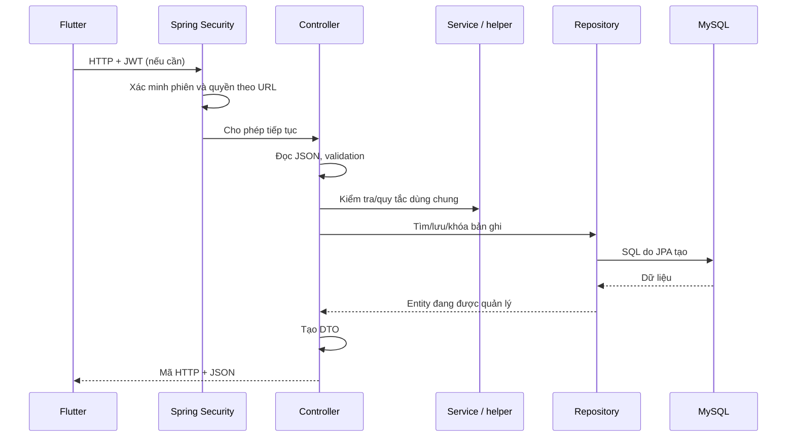
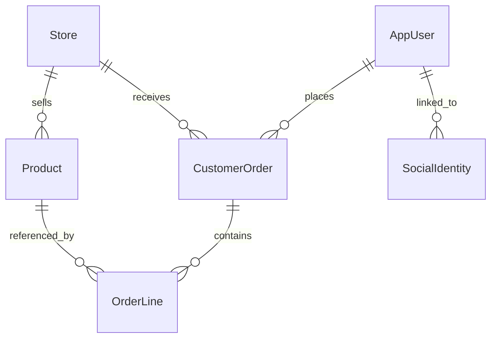
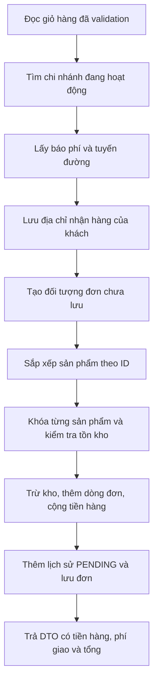
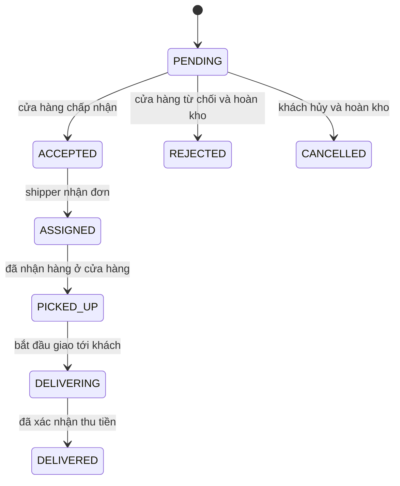

# Đọc hiểu backend C-Store từ đầu

Tài liệu này đi theo **source hiện có trong dự án**, không giả định bạn đã làm quen với Spring. Khi gặp tên lớp, mở file tương ứng trong `backend/src/main/java/com/cstore/app/`. Ví dụ `entity/Product.java` là đường dẫn tương đối trong thư mục đó.

Các đoạn đánh số dưới đây dùng **số thứ tự trong đoạn trích** để giải thích câu lệnh. Chúng không phải số dòng cố định của file; xuống dòng khi định dạng lại không làm thay đổi thứ tự xử lý. Dấu `...` trong đoạn minh họa chỉ phần đã lược khỏi ví dụ; muốn xem toàn bộ, mở file được liên kết.

## 1. Bắt đầu đọc theo thứ tự nào?

1. Đọc [CStoreApplication.java](../../backend/src/main/java/com/cstore/app/CStoreApplication.java) để biết chương trình bắt đầu ở đâu.
2. Đọc `entity/Product.java`, rồi `repository/Products.java`: một đối tượng sản phẩm liên quan thế nào đến dữ liệu trong MySQL?
3. Đọc `dto/ProductDtos.java`, rồi `controller/ProductController.java`: HTTP nhận gì và trả gì?
4. Đọc `controller/AuthController.java`, `service/AccountService.java`, rồi `config/SecurityConfig.java`: đăng nhập và kiểm tra quyền chạy ra sao?
5. Đọc `controller/OrderController.java` và `service/CommerceSupport.java`: tạo đơn, khóa tồn kho, hủy đơn và thu tiền.
6. Đọc `service/DeliveryService.java`, `service/RoutingService.java`, `controller/ShipperController.java`: phí, đường đi và giao hàng.
7. Đọc nhóm `Admin*Controller.java`, hồ sơ, ảnh và đăng nhập mạng xã hội.
8. Mở các test trong `backend/src/test/java/com/cstore/app/` để thấy tình huống thành công và bị từ chối.

Bạn không cần đọc toàn bộ Spring trước khi đọc dự án. Hãy chọn một thao tác trên app, tìm đường dẫn API của thao tác đó, rồi theo các lời gọi hàm xuống repository.

## 2. Thư mục và package đã được tách

```text
backend/
├── pom.xml                         Khai báo dự án Maven, Java và thư viện
└── src/
    ├── main/
    │   ├── java/com/cstore/app/
    │   │   ├── CStoreApplication.java
    │   │   ├── config/             Cấu hình Spring và tài khoản quản trị đầu tiên
    │   │   ├── controller/         Nhận HTTP và điều phối từng nhóm nghiệp vụ
    │   │   ├── dto/                Hình dạng JSON nhận vào/trả ra
    │   │   ├── entity/             Đối tượng được JPA lưu vào cơ sở dữ liệu
    │   │   ├── repository/         Các truy vấn dữ liệu
    │   │   ├── service/            Xử lý dùng chung, phiên đăng nhập, định tuyến
    │   │   ├── security/           Xác minh danh tính Google/Facebook
    │   │   ├── mapper/             Chuyển entity thành DTO an toàn
    │   │   ├── support/            Chuẩn hóa tên thương hiệu
    │   │   └── exception/          Đổi lỗi nghiệp vụ thành phản hồi HTTP
    │   └── resources/application.yml
    └── test/
        ├── java/com/cstore/app/     Test hành vi HTTP, dữ liệu, tuyến đường, OAuth
        └── resources/              Cấu hình hỗ trợ test
```

Đây là **package Java thực sự**: file `controller/AuthController.java` khai báo `package com.cstore.app.controller;`, không chỉ được đặt vào thư mục cho đẹp. `CStoreApplication` vẫn ở package cha `com.cstore.app` để Spring tìm các thành phần trong các package con.

Trong bản này, một số nghiệp vụ vẫn nằm ngay trong controller, đặc biệt vòng giao dịch tạo đơn và quản trị. Service chứa các phần dùng chung hoặc phụ thuộc dịch vụ khác. Vì vậy, khi đọc luồng, đừng mặc định mọi controller chỉ có một dòng gọi service; hãy xem đúng hàm đang được gọi.

### Bản đồ file

| Thư mục | File | Nhiệm vụ |
| --- | --- | --- |
| Gốc | `CStoreApplication.java` | Điểm vào `main`, khởi động Spring Boot |
| `config` | `SecurityConfig.java` | BCrypt, khóa JWT, giải mã token, quy tắc quyền theo URL |
| `config` | `AdminBootstrap.java` | Tạo admin đầu tiên từ cấu hình nếu email đó chưa tồn tại |
| `entity` | `AppUser.java` | Tài khoản, vai trò, ảnh, trạng thái khóa, tọa độ và phiên mật khẩu |
| `entity` | `Role.java` | Các giá trị `CUSTOMER`, `STORE`, `SHIPPER`, `ADMIN`, `MERCHANT` |
| `entity` | `Store.java` | Một chi nhánh và thông tin thương hiệu, chủ sở hữu, địa chỉ |
| `entity` | `Product.java` | Sản phẩm của một chi nhánh, giá, tồn kho và trạng thái bán |
| `entity` | `CustomerOrder.java` | Đơn hàng, người nhận, phí, shipper, thanh toán, lịch sử |
| `entity` | `OrderLine.java` | Một sản phẩm trong đơn cùng số lượng và giá tại thời điểm đặt |
| `entity` | `StatusEvent.java` | Một mốc trạng thái trong lịch sử đơn |
| `entity` | `SocialIdentity.java` | Liên kết danh tính Google/Facebook với tài khoản nội bộ |
| `repository` | `Users.java` | Tìm tài khoản theo email và lấy khóa ghi tài khoản |
| `repository` | `Stores.java` | Tìm chi nhánh, tìm chi nhánh do một người sở hữu |
| `repository` | `Products.java` | Sản phẩm theo chi nhánh, khóa ghi một sản phẩm |
| `repository` | `Orders.java` | Đơn theo khách/cửa hàng/shipper/trạng thái, đếm đơn đang giao |
| `repository` | `SocialIdentities.java` | Tìm liên kết theo nhà cung cấp và mã người dùng |
| `dto` | `AuthDtos.java` | Đăng ký, đăng nhập, người đang dùng và phiên JWT |
| `dto` | `AccountDtos.java` | Hồ sơ tài khoản an toàn và thông tin chi nhánh công khai |
| `dto` | `AdminDtos.java` | Tạo tài khoản/chi nhánh và kết quả thống kê quản trị |
| `dto` | `ProductDtos.java` | Dữ liệu tạo/sửa sản phẩm và dữ liệu sản phẩm trả về |
| `dto` | `OrderDtos.java` | Giỏ hàng gửi lên, dòng đơn, lịch sử, trạng thái và đơn trả về |
| `dto` | `DeliveryDtos.java` | Vị trí, báo phí, cửa hàng gần khách và dữ liệu chỉ đường |
| `dto` | `VerifiedSocialIdentity.java` | Danh tính chỉ được tạo sau khi đã xác minh với nhà cung cấp |
| `controller` | `AuthController.java` | Đăng ký, đăng nhập email, `/auth/me` |
| `controller` | `BranchController.java` | Danh sách chi nhánh đang hoạt động và đã ghim vị trí |
| `controller` | `CustomerController.java` | Vị trí giao hàng đã lưu, báo phí và tìm cửa hàng gần khách |
| `controller` | `ProductController.java` | Danh mục công khai và thao tác sản phẩm của cửa hàng |
| `controller` | `OrderController.java` | Tạo/xem/hủy đơn, duyệt đơn, xác nhận thu tiền |
| `controller` | `ShipperController.java` | Trực tuyến, tọa độ, nhận đơn, chỉ đường và các bước giao |
| `controller` | `AdminAccountController.java` | Tạo, khóa/mở, xóa mềm tài khoản |
| `controller` | `AdminStoreController.java` | Tạo thương hiệu/chi nhánh hoặc thêm tài khoản cho chi nhánh |
| `controller` | `AdminReportController.java` | Gom thương hiệu, doanh thu, phí nền tảng và chi nhánh lưu trữ |
| `controller` | `ProfileController.java` | Hồ sơ cá nhân và đổi mật khẩu |
| `controller` | `ImageController.java` | Kiểm tra, lưu ảnh PNG và trả ảnh qua HTTP |
| `controller` | `SocialAuthController.java` | Công bố provider đã bật và nhận yêu cầu đăng nhập OAuth |
| `service` | `AccountService.java` | Tạo người dùng, tạo DTO hồ sơ, kiểm tra trạng thái, phát hành JWT |
| `service` | `CommerceSupport.java` | Tìm tài khoản/chi nhánh hiện tại, kiểm tra sở hữu, khóa đơn, hoàn kho |
| `service` | `DeliveryService.java` | Kiểm tra phạm vi giao và tính phí từ tuyến đường |
| `service` | `RoutingService.java` | Gọi OSRM, đọc GeoJSON, cache tuyến và chọn tuyến ngắn nhất được trả về |
| `service` | `SocialAccounts.java` | Tìm/tạo tài khoản nội bộ sau khi xác minh danh tính xã hội |
| `security` | `GoogleIdentityVerifier.java` | Kiểm tra Google ID token và các claim bắt buộc |
| `security` | `FacebookIdentityVerifier.java` | Kiểm tra Facebook user token, app và email được chia sẻ |
| `mapper` | `CommerceViews.java` | Đổi sản phẩm/đơn JPA thành DTO, giữ ảnh/tên hàng lúc đặt |
| `mapper` | `BranchViews.java` | Đổi chi nhánh thành DTO công khai |
| `support` | `BrandNames.java` | Chuẩn hóa Unicode, khoảng trắng, chữ hoa/thường và chọn logo |
| `exception` | `ApiErrors.java` | Phản hồi JSON `message` cho lỗi nghiệp vụ/validation/ảnh |

## 3. Backend dùng những công nghệ nào?

Phiên bản khai báo trực tiếp nằm trong [pom.xml](../../backend/pom.xml); không cần tự chọn phiên bản cho các thư viện do Spring Boot quản lý.

| Thành phần | Trong dự án dùng để làm gì? |
| --- | --- |
| Java | Ngôn ngữ viết backend; `pom.xml` khai báo Java 21. Khi máy đang có Java khác, lệnh chạy dự án cho phép ghi đè `java.version` |
| Maven | Đọc `pom.xml`, tải thư viện, biên dịch, chạy test và đóng gói JAR |
| Spring Boot `3.4.12` | Khởi tạo ứng dụng và cấu hình tự động cho web, JPA, bảo mật |
| Spring Web / Spring MVC | Nhận HTTP, chọn controller, đổi JSON thành record và đổi kết quả thành JSON |
| Tomcat nhúng | Máy chủ HTTP được Spring Boot Web đưa vào ứng dụng; cổng hiện tại là 8080 |
| Spring Data JPA | Tạo triển khai repository và các truy vấn theo tên hàm |
| Jakarta Persistence / Hibernate | Ánh xạ entity sang bảng và ghi thay đổi entity trong transaction |
| MySQL Connector/J | Driver JDBC để backend kết nối MySQL |
| MySQL | Lưu tài khoản, chi nhánh, sản phẩm, đơn, dòng đơn, lịch sử và liên kết xã hội |
| HikariCP | Nhóm kết nối cơ sở dữ liệu do cấu hình datasource của Spring Boot sử dụng |
| Jakarta Bean Validation | Kiểm tra `@NotBlank`, `@Email`, `@Min`, tọa độ và dữ liệu đầu vào |
| Spring Security | Bộ lọc xác thực và kiểm tra quyền trước khi gọi controller |
| OAuth2 Resource Server / Nimbus JOSE JWT | Kiểm tra JWT của backend, giải mã/xác minh Google ID token, tạo JWT phiên |
| BCrypt | Băm và đối chiếu mật khẩu; backend không lưu mật khẩu gốc |
| Jackson | Chuyển JSON ↔ Java; cũng đọc JSON tuyến đường và provider |
| Java HTTP Client | Gọi dịch vụ tuyến đường OSRM trong `RoutingService` |
| Spring `RestTemplate` | Gọi HTTP phục vụ xác minh danh tính Google/Facebook |
| Java ImageIO | Đọc ảnh, kiểm tra kích thước, mã hóa lại thành PNG |
| JUnit / Spring Boot Test / MockMvc | Chạy test đơn vị và test các endpoint qua bộ xử lý Spring |
| Mockito | Thay phần xác minh provider bằng đối tượng giả trong test luồng đăng nhập |
| H2 | Cơ sở dữ liệu trong bộ nhớ cho các test; không thay MySQL của ứng dụng đang chạy |

`RestTemplate`, Hibernate, Jackson, Nimbus, Tomcat và HikariCP là các thành phần mà thư viện Spring Boot kéo vào theo nhu cầu. Không có bước cài từng JAR thủ công để chạy ứng dụng.

## 4. Java cơ bản cần biết ngay trong code này

| Cú pháp | Cách hiểu khi gặp trong source |
| --- | --- |
| `package com.cstore.app.entity;` | Lớp này thuộc nhóm entity; đường dẫn thư mục phản ánh tên package |
| `import ...Product;` | Cho phép dùng tên ngắn `Product` thay cho tên package đầy đủ |
| `import static ...CommerceSupport.bad;` | Cho phép gọi trực tiếp hàm tĩnh `bad(...)` |
| `class Product` | Khuôn mẫu để tạo các đối tượng sản phẩm |
| `interface Products` | Hợp đồng các truy vấn; Spring Data tạo đối tượng thực thi lúc khởi động |
| `record OrderInput(...)` | Kiểu dữ liệu bất biến theo cấu trúc; đọc bằng `input.storeId()`, không phải `input.storeId` |
| `enum Role` | Tập giá trị vai trò có giới hạn |
| `public` | Cho phép package khác truy cập |
| `private` | Chi tiết chỉ lớp hiện tại được dùng |
| `protected Product() {}` | Constructor không tham số cho JPA dựng đối tượng; code ứng dụng dùng constructor có dữ liệu |
| `final Users users` | Biến tham chiếu `users` không được gán lại sau khi khởi tạo |
| `static` | Thuộc lớp; gọi được mà không cần `new` đối tượng lớp đó |
| `this.users = users` | Gán tham số constructor vào trường của đối tượng hiện tại |
| `var order = ...` | Trình biên dịch suy ra kiểu từ biểu thức bên phải; không phải biến “không có kiểu” |
| `Long` và `long` | `Long` là kiểu đối tượng có thể `null`; `long` là số nguyên nguyên thủy |
| `Double` và `double` | `Double` cho phép biểu diễn “chưa có tọa độ” bằng `null` |
| `List<Product>` | Danh sách chỉ chứa các đối tượng `Product` |
| `Map<Long, ...>` | Bảng tra cứu theo khóa số ID |
| `Optional<Product>` | Kết quả có thể có hoặc không có sản phẩm; buộc người đọc xử lý trường hợp không tìm thấy |
| `u -> !u.deleted` | Lambda: nhận một phần tử `u`, trả về điều kiện giữ phần tử đó |
| `Store::isActive` | Tham chiếu phương thức; tương đương `store -> store.isActive()` |
| `.stream().filter(...).map(...).toList()` | Lọc các phần tử, chuyển từng phần tử, rồi thu thành danh sách mới |
| `throw ...` | Dừng nhánh xử lý hiện tại bằng một lỗi; lỗi sẽ đi tới lớp xử lý tương ứng |
| `try/catch/finally` | Thử xử lý, bắt lỗi phù hợp và luôn dọn tài nguyên ở `finally` |
| `BigDecimal` | Số thập phân dùng cho tiền. `add()`/`multiply()` trả số mới, phải nhận/gán lại kết quả |
| `Instant` | Một thời điểm; không phải chuỗi đã định dạng theo múi giờ Việt Nam |

Trong entity, các trường dữ liệu đang để `public` để code của các package con đọc/ghi trực tiếp theo cấu trúc đơn giản của dự án. JPA vẫn ánh xạ bằng các annotation đặt trên **trường**. Controller không trả trực tiếp `AppUser` ra ngoài; mapper/service tạo DTO không chứa `passwordHash`.

Ví dụ `product.stock -= item.quantity()` tương đương `product.stock = product.stock - item.quantity()`. Dòng đó thay đổi đối tượng sản phẩm đang được Hibernate quản lý trong transaction; xem phần transaction trước khi kết luận rằng “không gọi save thì không lưu”.

## 5. Từ `main` đến một request HTTP

File: [CStoreApplication.java](../../backend/src/main/java/com/cstore/app/CStoreApplication.java).

```java
@SpringBootApplication
public class CStoreApplication {
  public static void main(String[] args) {
    SpringApplication.run(CStoreApplication.class, args);
  }
}
```

| Dòng | Điều diễn ra |
| --- | --- |
| 1 | Bật cơ chế ứng dụng Spring Boot: cấu hình tự động và tìm component trong package gốc/các package con |
| 2 | Khai báo lớp đầu vào của ứng dụng |
| 3 | JVM gọi `main` khi chạy chương trình/JAR; `args` chứa các tham số dòng lệnh nếu có |
| 4 | Spring tạo application context, nạp cấu hình, nối các bean, khởi tạo repository/JPA và HTTP server |
| 5–6 | Kết thúc thân hàm/lớp; server vẫn tiếp tục chạy và chờ HTTP |

Spring nhìn thấy `@RestController`, `@Service`, `@Configuration` và tạo đối tượng cho các lớp đó. Khi constructor cần `Users`, `PasswordEncoder`, `RoutingService`, Spring đưa đúng bean vào. Đây là **dependency injection**: lớp khai báo thứ mình cần, thay vì tự `new` toàn bộ cây phụ thuộc.



Một số thao tác được repository gọi ngay trong controller; sơ đồ biểu diễn các vai trò, không buộc mọi endpoint phải đi qua cùng một service.

## 6. Entity, bảng dữ liệu và quan hệ

File: [entity/Product.java](../../backend/src/main/java/com/cstore/app/entity/Product.java).

```java
@Entity
@Table(name = "products")
public class Product {
  @Id
  @GeneratedValue(strategy = GenerationType.IDENTITY)
  public Long id;
  @ManyToOne(optional = false)
  public Store store;
  @Column(nullable = false)
  public String name;
  @Column(nullable = false, precision = 13, scale = 0)
  public BigDecimal price;
  @Column(nullable = false)
  public int stock;
}
```

Đây là phần trích các trường chính, còn ảnh, danh mục và constructor ở file thật.

| Dòng | Ý nghĩa |
| --- | --- |
| 1 | Đánh dấu lớp là entity được JPA quản lý |
| 2 | Chỉ định bảng SQL tên `products` |
| 3 | Khai báo lớp sản phẩm có thể được package khác truy cập |
| 4 | Đánh dấu trường ngay sau là khóa chính |
| 5 | ID do cơ sở dữ liệu sinh theo identity/auto increment |
| 6 | ID chưa lưu có thể `null`, vì vậy dùng `Long` |
| 7 | Nhiều sản phẩm có thể trỏ tới cùng một cửa hàng; quan hệ không được thiếu |
| 8 | Trong Java giữ tham chiếu `Store`; trong SQL JPA lưu khóa liên kết tới cửa hàng |
| 9–10 | Tên bắt buộc không `NULL` ở mức ánh xạ bảng |
| 11–12 | Giá tối đa 13 chữ số, không có phần thập phân theo ánh xạ hiện tại |
| 13–14 | Tồn kho là số nguyên; validation tạo/sửa sản phẩm yêu cầu không âm |
| 15 | Kết thúc lớp trích dẫn |

Các annotation khác trong entity:

| Annotation | Ở đâu / tác dụng |
| --- | --- |
| `@Enumerated(EnumType.STRING)` | Lưu vai trò bằng tên như `CUSTOMER`, không dùng số thứ tự enum |
| `@Column(unique = true)` | Email duy nhất ở cơ sở dữ liệu |
| `@UniqueConstraint` | Chống trùng cặp khóa thương hiệu–chi nhánh; chống trùng provider–subject |
| `@OneToMany(mappedBy = "order", cascade = ALL, orphanRemoval = true)` | Đơn có nhiều dòng hàng; lưu đơn mới sẽ lưu các dòng; phần quan hệ dùng trường `OrderLine.order` |
| `@Embeddable` | `StatusEvent` được nhúng thành dữ liệu lịch sử của đơn |
| `@ElementCollection` | Lưu danh sách các giá trị lịch sử, không cần entity có ID độc lập cho từng sự kiện |
| `@CollectionTable` | Chọn bảng phụ `order_status_history` và khóa nối tới đơn |
| `@OrderColumn` | Lưu số thứ tự để lịch sử trạng thái không bị đảo |
| `@Column(updatable = false)` | Thời điểm tạo tài khoản không được ghi đè trong các lần cập nhật JPA sau |
| `@DynamicUpdate` | Hibernate cập nhật các trường thay đổi của tài khoản; giữ hành vi cập nhật hiện có |

Quan hệ chính:



Còn có liên kết tài khoản–chi nhánh được gán, chủ sở hữu cửa hàng, shipper của đơn, người xác nhận thu tiền và danh sách sự kiện. Xem từng trường trong `AppUser`, `Store`, `CustomerOrder` để đọc đầy đủ; sơ đồ trên tập trung đường đi của hàng hóa/đơn.

`OrderLine` lưu `productName`, `productImage`, `unitPrice` tại lúc đặt. Nếu cửa hàng sửa tên/ảnh/giá sau đó, lịch sử đơn vẫn đọc ảnh chụp dữ liệu cũ. Mapper chỉ dùng dữ liệu sản phẩm hiện tại làm phương án tương thích cho các bản ghi cũ chưa có trường chụp lại.

## 7. Repository chạy SQL như thế nào?

File: [repository/Products.java](../../backend/src/main/java/com/cstore/app/repository/Products.java).

```java
public interface Products extends JpaRepository<Product, Long> {
  public List<Product> findByStoreIdOrderByIdDesc(Long id);
  @Lock(LockModeType.PESSIMISTIC_WRITE)
  @Query("select p from Product p where p.id = :id")
  public Optional<Product> locked(Long id);
}
```

| Dòng | Ý nghĩa |
| --- | --- |
| 1 | Repository quản lý entity `Product`, khóa chính `Long`; kế thừa các hàm `findById`, `findAll`, `save`, `flush`… |
| 2 | Spring Data phân tích tên: `findBy` = tìm; `StoreId` = ID của cửa hàng liên kết; `OrderByIdDesc` = ID giảm dần |
| 3 | Yêu cầu khóa ghi bản ghi trong transaction để các giao dịch khác không cùng sửa tự do |
| 4 | Đây là **JPQL**, truy vấn entity `Product` và thuộc tính `id`; không phải viết trực tiếp tên bảng `products` |
| 5 | Nhận ID, trả `Optional` vì sản phẩm có thể không tồn tại |
| 6 | Kết thúc interface; Spring Data tạo phần triển khai lúc ứng dụng khởi động |

Tại sao phải khóa? Giả sử chỉ còn 1 sản phẩm, hai khách cùng đặt. Nếu cả hai cùng đọc tồn kho 1 rồi cùng trừ, hệ thống có thể nhận quá số lượng. `products.locked(...)` và transaction buộc mỗi lượt kiểm tra–trừ tồn kho diễn ra với khóa thích hợp. Các sản phẩm trong giỏ được khóa theo ID tăng dần để giảm trường hợp hai giao dịch giữ khóa chéo nhau.

`users.locked(email)` còn bảo vệ lúc shipper nhận đơn: kiểm tra giới hạn 3 đơn và nhận đơn mới phải nằm trong cùng một chuỗi khóa, tránh hai yêu cầu đồng thời cùng vượt hạn mức.

## 8. DTO và validation: JSON vào được kiểm tra ở đâu?

File: [dto/ProductDtos.java](../../backend/src/main/java/com/cstore/app/dto/ProductDtos.java).

`ProductInput` yêu cầu tên không trống, giá từ 1 trở lên, tồn kho không âm và có danh mục. `ProductView` là dữ liệu trả về, có thêm ID sản phẩm, ID/tên cửa hàng, ảnh và trạng thái bán.

| Annotation đầu vào | Ý nghĩa trong dự án |
| --- | --- |
| `@RequestBody` | Đọc JSON HTTP body vào kiểu Java |
| `@Valid` | Chạy Bean Validation cho đối tượng và các phần tử có khai báo validation lồng nhau |
| `@NotBlank` | Chuỗi bắt buộc phải có ký tự không phải khoảng trắng |
| `@NotNull` | Trường không được thiếu/null |
| `@Email` | Kiểm tra cấu trúc email; không chứng minh email đang nhận được thư |
| `@Size(min = 8, max = 72)` | Giới hạn độ dài chuỗi mật khẩu theo validation đầu vào |
| `@Min(0)` / `@Min(1)` | Số nguyên từ 0 / từ 1 |
| `@DecimalMin` / `@DecimalMax` | Giới hạn giá và miền latitude/longitude |
| `@NotEmpty` | Danh sách hàng đặt không được rỗng |
| `@Pattern` | Điện thoại dạng 0 + 9 chữ số, hoặc giới tính/provider thuộc các lựa chọn cho phép |
| `@AssertTrue` | Người dùng phải xác nhận vị trí ghim; không tự lấy tọa độ mẫu để đặt đơn |

Validation hình dạng không thay thế kiểm tra nghiệp vụ. Giá 10.000 và số lượng 2 có thể hợp lệ về kiểu; controller còn phải kiểm tra sản phẩm có thuộc chi nhánh đó, còn bán và còn đủ hàng hay không.

Các record có mật khẩu/token đã ghi đè `toString()` để che giá trị nhạy cảm khi đối tượng vô tình được chuyển thành chuỗi. Điều này không có nghĩa có thể bật log HTTP body chứa thông tin đăng nhập; cấu hình hiện tại tránh log chi tiết request/response đó.

## 9. Đọc từng bước đăng nhập email

File: [controller/AuthController.java](../../backend/src/main/java/com/cstore/app/controller/AuthController.java).

Đọc toàn hàm `login` trong file thật. Các bước theo thứ tự là:

1. `@PostMapping("/auth/login")`: kết hợp với prefix `/api`, endpoint là `POST /api/auth/login`.
2. `@Transactional(readOnly = true)`: thao tác này đọc tài khoản và thông tin cần tạo phiên; không phải giao dịch ghi.
3. `@Valid @RequestBody Login input`: Jackson đọc JSON; validation từ chối email/mật khẩu trống trước khi vào thân hàm.
4. `users.findByEmailIgnoreCase(input.email().trim())`: bỏ khoảng trắng đầu/cuối và tìm email không phân biệt hoa/thường.
5. `.orElseThrow(...)`: không có email thì trả lỗi 401, không chạy các dòng tiếp theo.
6. `user.passwordHash == null`: tài khoản không có giá trị băm mật khẩu sử dụng được thì không đăng nhập bằng mật khẩu.
7. `user.passwordHash.startsWith("!")`: dấu hiệu tài khoản chỉ đăng nhập mạng xã hội trong cấu trúc hiện tại.
8. `passwords.matches(input.password(), user.passwordHash)`: BCrypt đối chiếu mật khẩu nhập với giá trị băm; không giải mã hash thành mật khẩu gốc.
9. Nếu điều kiện sai, ném cùng thông báo 401 để không phân biệt rõ email sai hay mật khẩu sai.
10. `accounts.session(user)`: kiểm tra tài khoản đang được phép dùng, tạo JWT và DTO hồ sơ rồi trả về app.

### `AccountService.session` tạo phiên gì?

File: [service/AccountService.java](../../backend/src/main/java/com/cstore/app/service/AccountService.java).

```java
var now = Instant.now();
var claims =
    JwtClaimsSet.builder()
        .subject(user.email)
        .issuedAt(now)
        .expiresAt(now.plusSeconds(28800))
        .claim("role", user.role.name())
        .claim("ver", user.version())
        .build();
String token =
    jwt.encode(JwtEncoderParameters.from(JwsHeader.with(MacAlgorithm.HS256).build(), claims))
        .getTokenValue();
return new Session(token, account(user));
```

| Dòng | Tác dụng |
| --- | --- |
| 1 | Lấy thời điểm hiện tại |
| 2–3 | Bắt đầu xây bộ dữ liệu claim của JWT |
| 4 | `sub` là email dùng nhận diện tài khoản trong ứng dụng |
| 5 | Lưu thời điểm phát hành |
| 6 | Hết hạn sau 28.800 giây, tức 8 giờ |
| 7 | Gắn vai trò để Spring Security kiểm tra nhóm URL |
| 8 | Gắn phiên bản xác thực; token phiên cũ sẽ mất hiệu lực sau đổi mật khẩu |
| 9 | Hoàn thành đối tượng claim |
| 10–12 | Ký bộ claim bằng HS256 và lấy chuỗi JWT |
| 13 | Trả phiên gồm token và dữ liệu hồ sơ an toàn, không có hash mật khẩu |

JWT có chữ ký để phát hiện dữ liệu bị sửa. Không nên hiểu nó là phần lưu dữ liệu bí mật đã mã hóa: client có thể đọc phần claim của JWT. Vì vậy source không đưa mật khẩu hay khóa ký vào claim.

### Đăng ký khác đăng nhập ở đâu?

`AuthController.register` chỉ cho tự đăng ký `CUSTOMER` hoặc `SHIPPER`, kiểm tra email chưa tồn tại, chuẩn hóa email, băm mật khẩu, lưu user rồi trả 201. Tài khoản cửa hàng/admin được tạo qua luồng quản trị. Flutter hiện gọi đăng nhập sau khi đăng ký thành công, nên không cần backend tự phát token trong phản hồi đăng ký.

`AccountService.account` tìm chi nhánh của tài khoản cửa hàng, chọn logo thương hiệu làm avatar của tài khoản cửa hàng, chuyển role dữ liệu cũ `MERCHANT` thành `STORE` trong DTO và tính các cờ như `photoRequired`, `passwordEnabled`, `storeOwner`.

## 10. Spring Security chặn trước controller

File: [config/SecurityConfig.java](../../backend/src/main/java/com/cstore/app/config/SecurityConfig.java).

- `passwordEncoder()` tạo BCrypt encoder để dùng chung lúc tạo tài khoản và đối chiếu mật khẩu.
- `jwtKey(...)` đọc tên biến cấu hình `JWT_SECRET`, kiểm tra độ dài rồi tạo khóa HMAC. Tài liệu chỉ nêu tên cấu hình, không chép giá trị thật.
- `jwtEncoder(...)` ký JWT do chính backend phát hành.
- `jwtDecoder(...)` kiểm tra chữ ký HS256, thời hạn token và trạng thái tài khoản trong DB.
- `activeAccount` yêu cầu tài khoản chưa khóa, chưa xóa và `ver` của token bằng `authVersion` hiện tại của user.
- `JwtGrantedAuthoritiesConverter` đọc claim `role` và tạo authority bắt đầu bằng `ROLE_`.
- `SessionCreationPolicy.STATELESS` nghĩa là backend không dựa vào HTTP session của server để nhớ lượt đăng nhập này; request mang JWT.
- Cấu hình hiện tại tắt CSRF cho luồng API bearer-token này. Đây là mô tả cấu hình của dự án, không phải quy tắc áp dụng cho mọi loại website.

| URL / phương thức | Quyền trong cấu hình |
| --- | --- |
| `POST /api/auth/login`, `/register`, `/social` | Công khai |
| `GET /api/products`, `/branches`, `/images/**`, `/auth/providers` | Công khai |
| `/api/admin/**` | `ADMIN` |
| `/api/merchant/**` | `STORE` hoặc vai trò tương thích cũ `MERCHANT` |
| `/api/customer/**` | `CUSTOMER` |
| `/api/shipper/**` | `SHIPPER` |
| Các yêu cầu còn lại | Phải xác thực |

Sau quyền theo URL vẫn có quyền theo **bản ghi**. Ví dụ một cửa hàng được vào `/merchant/**` nhưng không được sửa sản phẩm của cửa hàng khác. `CommerceSupport.myStore`, `ownedProduct`, `checkShipper` và các kiểm tra ID đơn sẽ chặn trường hợp đó.

`Authentication.getName()` trong luồng JWT này lấy subject email. `CommerceSupport.current` dùng email đó tìm user đang hoạt động, không nhận một `userId` tùy ý do client gửi để quyết định người đang đăng nhập.

## 11. Transaction, dirty checking và lý do không gọi `save` ở mọi dòng

`@Transactional` tạo ranh giới giao dịch. Khi một phương thức ghi hoàn tất bình thường, JPA/Hibernate flush các thay đổi hợp lệ và giao dịch commit. Khi lỗi runtime như `ResponseStatusException` thoát ra khỏi phương thức, giao dịch được rollback theo cấu hình transaction mặc định đang dùng.

Ví dụ trong `ProductController.update`:

```java
var product = support.ownedProduct(authentication, id);
product.name = input.name().trim();
product.price = input.price();
product.stock = input.stock();
product.category = input.category().trim();
return view(product);
```

| Dòng | Ý nghĩa |
| --- | --- |
| 1 | Tìm sản phẩm có khóa ghi, kiểm tra người dùng quản lý đúng chi nhánh |
| 2 | Chuẩn hóa tên sản phẩm trên entity đang được quản lý |
| 3 | Đổi giá |
| 4 | Đổi tồn kho theo dữ liệu đã validation |
| 5 | Đổi danh mục |
| 6 | Tạo DTO phản hồi; cuối phương thức transaction, Hibernate phát hiện các trường đã thay đổi và ghi DB |

Cơ chế theo dõi thay đổi này gọi là **dirty checking**. Entity vừa `new` chưa tự trở thành bản ghi; `save` ở thao tác tạo là cần thiết. Entity lấy từ repository trong transaction đang mở được JPA quản lý, nên các phép gán của thao tác cập nhật được lưu khi commit.

`@Transactional(readOnly = true)` ở cấp controller đặt mặc định cho các thao tác đọc. Phương thức ghi có `@Transactional` riêng để mở giao dịch ghi. `spring.jpa.open-in-view: false` nghĩa là tầng hiển thị HTTP không tự giữ persistence context mở suốt quá trình trả dữ liệu; source tạo DTO khi còn trong phạm vi xử lý phù hợp.

Không gọi `locked(...)` tùy tiện ngoài transaction. Khóa phải tồn tại đủ lâu để bao trùm cả kiểm tra lẫn thay đổi dữ liệu.

## 12. Đặt hàng: đọc theo thứ tự thực thi

File: [controller/OrderController.java](../../backend/src/main/java/com/cstore/app/controller/OrderController.java), hàm `checkout`.



Các câu lệnh chính:

1. `stores.findById(input.storeId())`: tìm đúng chi nhánh client chọn.
2. `.filter(Store::isActive)`: bỏ chi nhánh đã ngừng hoạt động hoặc có chủ đã xóa.
3. `.orElseThrow(...)`: không tìm được chi nhánh hợp lệ thì dừng trước khi tạo đơn.
4. Kiểm tra latitude/longitude chi nhánh: không tự điền một tọa độ mẫu.
5. `delivery.quote(...)`: lấy đường đi và phí thật. Không có tuyến hợp lệ thì đơn chưa được tạo và chưa bị trừ kho.
6. `support.current(authentication)`: xác định người mua từ phiên đã xác thực.
7. Gán `deliveryAddress`, `deliveryLatitude`, `deliveryLongitude` cho người mua: lần sau app có thể tải lại vị trí đã xác nhận.
8. `new CustomerOrder(buyer, store)`: tạo đối tượng trong bộ nhớ, liên kết khách–chi nhánh.
9. Gán người nhận, điện thoại, địa chỉ, vị trí, km, thời gian và phí báo được cho đơn.
10. `Set<Long> seen = new HashSet<>()`: tập ID dùng kiểm tra sản phẩm gửi trùng trong cùng giỏ.
11. `.sorted(Comparator.comparing(OrderItemInput::productId))`: mọi giao dịch khóa sản phẩm theo ID tăng dần.
12. `!seen.add(item.productId())`: `add` trả `false` khi ID đã có, nên từ chối sản phẩm trùng.
13. `products.locked(...)`: khóa ghi sản phẩm để đọc tồn kho nhất quán với thao tác trừ.
14. Kiểm tra chi nhánh và `active`: không được trộn hàng của nhiều chi nhánh hoặc đặt sản phẩm ngừng bán.
15. `product.stock < item.quantity()`: không đủ hàng thì lỗi 409; các thay đổi trước đó trong giao dịch sẽ không được commit.
16. `product.stock -= item.quantity()`: giữ số hàng cho đơn ngay lúc đặt, không chờ cửa hàng bấm chấp nhận.
17. `new OrderLine(...)`: giữ sản phẩm, số lượng, giá, tên và ảnh tại lúc đặt.
18. `order.total = order.total.add(...)`: cộng tiền hàng. BigDecimal không tự đổi giá trị cũ nên phải gán kết quả.
19. `new StatusEvent("PENDING")`: thêm trạng thái đầu tiên kèm thời điểm.
20. `orders.save(order)`: lưu đơn, các dòng hàng được lưu qua quan hệ cascade.
21. `view(...)`: mapper đổi entity thành DTO an toàn để Jackson trả JSON.

**Tên trường cần đọc kỹ:** `CustomerOrder.total` trong DB là **tiền hàng**. `CommerceViews` trả tiền đó vào JSON `subtotal`, còn JSON `total` là tiền hàng cộng `fee`. Đừng dùng tên biến để suy ra sai công thức.

## 13. Từ chờ xác nhận đến hoàn thành



| Thao tác | File / điều kiện chính |
| --- | --- |
| Cửa hàng duyệt đơn | `OrderController.storeStatus`: đúng chi nhánh, đơn còn `PENDING`, chỉ chọn `ACCEPTED` hoặc `REJECTED`; từ chối phải có lý do |
| Khách hủy | `OrderController.cancel`: đúng người mua và đơn còn `PENDING` |
| Hoàn kho | `CommerceSupport.restore`: khóa sản phẩm theo cùng thứ tự ID và cộng lại số lượng từng dòng |
| Shipper trực tuyến | `ShipperController.location`: bắt buộc có ảnh cá nhân nếu muốn online; lưu tọa độ và trạng thái |
| Tìm đơn có thể nhận | `ShipperController.offers`: shipper online, có tọa độ, đơn được chấp nhận, cửa hàng hoạt động, trong 5 km đường đi |
| Nhận đơn | `ShipperController.claim`: khóa tài khoản và đơn; kiểm tra lại mọi điều kiện; tối đa 3 đơn ở trạng thái đang giao |
| Chuyển bước giao | `ShipperController.deliveryStatus`: chỉ `ASSIGNED → PICKED_UP → DELIVERING → DELIVERED` |
| Thu tiền | `OrderController.payment`: đúng người có quyền với đơn, đúng giai đoạn, chưa xác nhận lần trước |

`setStatus` đồng thời sửa trạng thái hiện tại và thêm một `StatusEvent`, để app hiển thị được cả trạng thái mới lẫn lịch sử.

`paidAt` và `status` là hai dữ liệu khác nhau. Một đơn có thể đã thu tiền nhưng chưa đánh dấu hoàn tất; báo cáo doanh thu chỉ tính đơn vừa `DELIVERED` vừa có `paidAt`. Shipper không được hoàn thành đơn khi chưa xác nhận thu tiền.

`simulateArrival` chỉ được dùng ở bước từ `ASSIGNED` sang `PICKED_UP`. Backend cập nhật tọa độ mô phỏng tới cửa hàng và đặt cờ `simulated`; việc này phục vụ kiểm thử/demo, không chứng minh GPS trên thiết bị thật.

## 14. Tuyến đường, khoảng cách và phí giao

File: [service/DeliveryService.java](../../backend/src/main/java/com/cstore/app/service/DeliveryService.java).

Luồng `quote`:

1. `validCoordinates`: phải là số hữu hạn, latitude từ -90 đến 90, longitude từ -180 đến 180.
2. Chi nhánh còn hoạt động và đã có vị trí.
3. Haversine sàng lọc nhanh: điểm quá xa theo đường thẳng không cần gọi dịch vụ tuyến đường.
4. `routing.route(...)` lấy đường đi thực tế.
5. Nếu đường đi dài hơn 10 km, từ chối giao.
6. Tạo `DeliveryQuote` gồm ID chi nhánh, km, thời gian, phí và hình học tuyến.

Công thức nguồn đang dùng:

```java
BigDecimal.valueOf(15000 + (long) Math.ceil(route.distanceKm() * 3000))
```

| Thành phần | Nghĩa |
| --- | --- |
| `route.distanceKm()` | Độ dài đường đi bằng km |
| `* 3000` | Phần phí tăng theo quãng đường |
| `Math.ceil(...)` | Làm tròn phần phí này lên tới một đơn vị đồng |
| `(long)` | Đổi kết quả số thực đã làm tròn sang số nguyên |
| `15000 + ...` | Cộng phí cơ bản |
| `BigDecimal.valueOf(...)` | Đưa số tiền về cùng kiểu dùng trong dữ liệu đơn |

Ví dụ tuyến 3,12 km: `ceil(3,12 × 3000) = 9360`, phí là 24.360 đồng. Source **không** làm tròn quãng đường 3,12 thành 4 km trước khi nhân.

File: [service/RoutingService.java](../../backend/src/main/java/com/cstore/app/service/RoutingService.java).

- Gọi OSRM qua Java HTTP Client; URL mặc định lấy từ `${ROUTING_BASE_URL:...}` trong constructor.
- Thứ tự tọa độ trong URL/GeoJSON là **longitude, latitude**. Đây là điểm rất dễ đảo khi nối với widget bản đồ thường nhận `LatLng(latitude, longitude)` ở Flutter.
- Yêu cầu nhiều tuyến thay thế và geometry/steps đầy đủ.
- Kiểm tra phản hồi có `code = Ok`, khoảng cách/thời gian hữu hạn không âm, hình học có ít nhất 2 điểm hợp lệ.
- Nếu điểm ghim bị dịch sang đường ở khoảng cách lớn hơn 500 m, yêu cầu người dùng chọn điểm gần đường hơn.
- Duyệt các tuyến được trả về và chọn tuyến có `distanceKm` nhỏ nhất. Cờ `SHORTEST_AVAILABLE` nghĩa là ngắn nhất trong các phương án OSRM trả về, không khẳng định đã duyệt mọi đường có thể tồn tại.
- `synchronized` cho các yêu cầu tuyến chạy lần lượt; khoảng nghỉ giữa lần gọi ra ngoài là khoảng 1.100 ms theo mã hiện tại.
- Cache theo tọa độ làm tròn 6 chữ số, thời hạn 10 phút, tối đa 256 mục; yêu cầu lặp có thể dùng lại dữ liệu.
- `InterruptedException` khôi phục cờ ngắt bằng `Thread.currentThread().interrupt()` trước khi trả lỗi.
- Không có đường hợp lệ: lỗi 400. Dịch vụ/phản hồi không dùng được: lỗi 503. Source không giả khoảng cách 0 hoặc dùng đường thẳng để báo phí thay thế.

Chỉ đường shipper lấy chặng tới cửa hàng khi chưa nhận hàng; sau khi nhận hàng, chặng hoạt động đổi sang điểm giao cho khách. Đơn hoàn tất trả stage `COMPLETED`.

## 15. Quản trị tài khoản, thương hiệu và doanh thu

### Tạo/khóa/xóa tài khoản

`AdminAccountController`:

- Danh sách loại các tài khoản đã xóa mềm.
- Tạo tài khoản `STORE` phải gắn với chi nhánh tồn tại, còn hoạt động, đã ghim vị trí.
- Tài khoản không phải cửa hàng không được gắn `storeId`.
- Không cho dùng role cũ `MERCHANT` khi tạo mới; dùng `STORE`.
- Không cho admin khóa/xóa chính tài khoản đang đăng nhập.
- Khóa tài khoản đồng thời đưa trạng thái shipper về offline.
- Xóa chủ cửa hàng có đơn đang xử lý bị từ chối. Khi được xóa, chi nhánh được lưu trữ, nhân viên liên quan bị khóa/offline và lịch sử đơn vẫn giữ lại.

### Tạo thương hiệu/chi nhánh

`AdminStoreController.create`:

1. Nếu có `existingStoreId`, tìm và kiểm tra chi nhánh được chọn, yêu cầu vị trí gửi lên trùng vị trí chi nhánh đó.
2. Nếu tạo chi nhánh mới, yêu cầu tên thương hiệu, chuẩn hóa khoảng trắng.
3. `BrandNames.normalize` dùng Unicode NFKC, trim, gom khoảng trắng và viết thường để tạo khóa so sánh. Hàm này không xóa dấu tiếng Việt.
4. Gỡ khóa duy nhất của chi nhánh đã lưu trữ rồi `flush` để dữ liệu cũ không giữ tên của chi nhánh hoạt động mới.
5. Tìm các chi nhánh đang hoạt động cùng thương hiệu.
6. Nếu đã có chi nhánh, bắt buộc nhập tên chi nhánh mới; kiểm tra không trùng tên trong thương hiệu.
7. Tạo tài khoản cửa hàng bằng `AccountService.newUser`; mật khẩu được băm.
8. Tạo chi nhánh khi cần, dùng logo hiện có của thương hiệu nếu tìm được, gán tài khoản vào chi nhánh rồi trả DTO.

Tên hiển thị chi nhánh mới có thể là `Thương hiệu · Tên chi nhánh`. Trường `name` vẫn được nhận cho ứng dụng cũ; trường `branchName` là tên nhánh rõ nghĩa của luồng hiện tại.

### Báo cáo doanh thu

`AdminReportController.revenue`:

1. Lấy các đơn `DELIVERED`, chỉ giữ đơn có `paidAt`.
2. Gom theo ID chi nhánh.
3. Cộng `order.total`: đây là tiền hàng trong entity, không bao gồm phí giao hàng.
4. Tính `platformRevenue = grossSales × 0.15`.
5. Gom các dòng chi nhánh theo khóa thương hiệu chuẩn hóa.
6. Đếm riêng chi nhánh đang hoạt động và đã lưu trữ.
7. Sắp thương hiệu theo doanh thu giảm dần, dùng khóa tên để giữ thứ tự xác định khi bằng doanh thu.
8. `topBrand` là thương hiệu đầu tiên có doanh thu dương; chưa có doanh thu thì có thể `null`.

Chi nhánh lưu trữ vẫn có thể đóng góp vào lịch sử doanh thu. Danh sách chi nhánh công khai và danh sách thương hiệu hoạt động lại loại chi nhánh lưu trữ. Hai danh sách phục vụ hai mục đích khác nhau.

## 16. Hồ sơ, ảnh và mật khẩu

### Hồ sơ

`ProfileController.profile` dùng tài khoản từ phiên; `update` lấy khóa tài khoản rồi sửa tên, điện thoại, giới tính theo các trường có gửi lên. Điện thoại rỗng được chuyển thành không có số; giới tính giới hạn ở `MALE`, `FEMALE`, `UNSPECIFIED`.

### Đổi mật khẩu

1. Khóa tài khoản bằng email đã xác thực.
2. Nếu chỉ có đăng nhập mạng xã hội, từ chối luồng đổi mật khẩu nội bộ.
3. Đối chiếu mật khẩu hiện tại bằng BCrypt.
4. Ngoài giới hạn độ dài chuỗi của DTO, kiểm tra độ dài UTF-8 của mật khẩu mới không quá 72 byte.
5. Không cho dùng lại mật khẩu hiện tại.
6. Băm mật khẩu mới, tăng `authVersion`.
7. Tạo phiên mới. Token có `ver` cũ không còn qua bộ kiểm tra `activeAccount`.

### Lưu/đọc ảnh

`ImageController.writeImage` không tin riêng phần mở rộng tên file:

1. Từ chối file rỗng hoặc lớn hơn 5 MB.
2. Tạo ImageInputStream, tìm reader ảnh mà Java ImageIO đang có thể đọc.
3. Kiểm tra không vượt 16 megapixel trước khi đọc ảnh đầy đủ.
4. Đọc ảnh và luôn giải phóng reader trong `finally`.
5. Sinh tên UUID, mã hóa lại thành `.png`, ghi vào thư mục upload.
6. Trả đường dẫn `/api/images/<tên>.png` để lưu trong dữ liệu.

Endpoint đọc ảnh chỉ nhận tên phù hợp mẫu, resolve/normalize đường dẫn và kiểm tra file vẫn nằm trong thư mục upload. Phản hồi đặt `image/png`, `nosniff`, cache 7 ngày.

Upload logo chi nhánh cập nhật logo cho các chi nhánh đang hoạt động cùng thương hiệu. Tài khoản cửa hàng dùng logo thương hiệu, không tải avatar cá nhân thay thế. Khách có thể xóa ảnh; shipper phải giữ một ảnh và có thể thay bằng ảnh khác.

## 17. Google/Facebook đi qua các lớp nào?

```text
Flutter lấy thông tin xác thực từ SDK nhà cung cấp
    ↓ POST /api/auth/social
SocialAuthController
    ↓ GoogleIdentityVerifier hoặc FacebookIdentityVerifier
VerifiedSocialIdentity
    ↓ SocialAccounts.resolve
AppUser nội bộ
    ↓ AccountService.session
JWT của C-Store + DTO hồ sơ
```

Token từ Google/Facebook và JWT của C-Store là hai loại dữ liệu có vai trò khác nhau. API nghiệp vụ C-Store dùng JWT do backend phát hành sau khi xác minh provider.

`GET /api/auth/providers` cho biết từng provider đã có cấu hình đủ để bật hay chưa. ID/secret không được cấu hình thì provider tương ứng tắt; luồng email vẫn độc lập.

### Google

`GoogleIdentityVerifier` dùng Nimbus decoder với endpoint khóa công khai cố định của Google, rồi kiểm tra issuer, audience chứa client ID của ứng dụng, thời điểm hết hạn, thời điểm phát hành không ở quá xa tương lai và `email_verified = true`. Tên/email/subject được kiểm tra độ dài và cấu trúc trước khi tạo `VerifiedSocialIdentity`.

### Facebook

`FacebookIdentityVerifier` gọi `debug_token`, kiểm tra token hợp lệ, đúng app, đúng loại `USER`, có ID và thời hạn còn hiệu lực. Sau đó lấy hồ sơ `me`, kiểm tra ID trùng và cần email được chia sẻ. `appsecret_proof` được tính bằng HMAC-SHA256. Chi tiết token/secret không được đưa vào thông báo lỗi trả app.

### Liên kết nội bộ

`SocialAccounts.resolve` ưu tiên liên kết đã có theo provider–subject. Nếu chưa có, chuẩn hóa email, tìm tài khoản cùng email hoặc tạo khách hàng mới với dấu hiệu chỉ đăng nhập xã hội, rồi lưu liên kết. Cả việc tạo tài khoản/liên kết nằm trong transaction. Đọc đúng hành vi này khi tìm hiểu cách dự án nhận diện người dùng; không giả định có một màn liên kết tài khoản riêng nếu source không có.

## 18. Mã lỗi phản hồi

File: [exception/ApiErrors.java](../../backend/src/main/java/com/cstore/app/exception/ApiErrors.java).

| Trường hợp | HTTP / cách xử lý |
| --- | --- |
| Dữ liệu/quy tắc nghiệp vụ không hợp lệ | Thường 400 với JSON có `message` |
| Không đăng nhập / token không hợp lệ / mật khẩu sai | 401; lỗi từ bộ lọc bảo mật có thể khác hình dạng JSON lỗi controller |
| Đăng nhập nhưng không có quyền | 403 |
| Không tìm thấy bản ghi/ảnh | 404 |
| Email/tên đã tồn tại, thiếu tồn kho, đơn đã thay đổi | 409 tùy thao tác |
| File vượt giới hạn upload | 413 |
| Không lấy được dịch vụ tuyến đường hợp lệ | 503 |

`MethodArgumentNotValidException` lấy lỗi trường đầu tiên làm thông báo. `DataIntegrityViolationException` được chuyển thành 409 để trường hợp trùng dữ liệu hoặc thay đổi đồng thời không trả lỗi SQL thô ra app. `ResponseStatusException` giữ mã và lý do đã chọn ở nghiệp vụ.

## 19. Cấu hình và chạy thử

Cấu hình không phải code chạy từ trên xuống giống `main`; Spring đọc cấu hình khi khởi động để tạo các thành phần.

| Cấu hình | Tác dụng |
| --- | --- |
| `server.port: 8080` | Cổng HTTP backend |
| `spring.config.import` | Cho phép đọc cấu hình cục bộ từ `.env` phía gốc dự án |
| `spring.datasource.*` | URL JDBC/tài khoản kết nối MySQL; giá trị bí mật không chép vào tài liệu |
| `spring.jpa.hibernate.ddl-auto: update` | Đồng bộ schema phục vụ môi trường hiện tại; bản refactor giữ nguyên tên bảng/cột |
| `spring.jpa.open-in-view: false` | Không giữ context JPA bằng cơ chế open-in-view |
| `multipart.max-file-size`, `max-request-size` | Giới hạn kích thước file/request upload |
| `JWT_SECRET` | Khóa ký JWT, được đọc bởi SecurityConfig |
| `ADMIN_EMAIL`, `ADMIN_PASSWORD` | Cấu hình khởi tạo admin đầu tiên; không tạo lại nếu email đã có |
| `ROUTING_BASE_URL` | Dịch vụ OSRM lấy đường đi |
| `UPLOAD_DIR` | Thư mục lưu ảnh; mặc định tương đối với thư mục backend khi chạy |
| Các biến `GOOGLE_*`, `FACEBOOK_*` | Cấu hình provider, chỉ nêu tên và mục đích, không đưa giá trị thật vào log/tài liệu |

Các lệnh chạy kiểm tra phải dùng công cụ log của dự án từ thư mục gốc. Ví dụ cho máy có Java 25 như môi trường đã kiểm tra:

```bash
python3 scripts/run-visible.py --name backend-test --cwd backend -- mvn -Djava.version=25 test
```

Từng thành phần:

- `python3`: chạy Python interpreter.
- `scripts/run-visible.py`: mở/dùng lại cửa sổ Kitty và ghi log trong `.local/visible-tests/`.
- `--name backend-test`: nhãn dễ đọc cho lượt chạy, không chứa thông tin đăng nhập.
- `--cwd backend`: lệnh thật được chạy trong thư mục backend.
- `--`: kết thúc các tham số của công cụ log; phần sau là lệnh cần chạy.
- `mvn`: Maven đọc `backend/pom.xml`.
- `-Djava.version=25`: đặt property Java theo phiên bản đang cài. Trên máy khác hãy đối chiếu `java -version`; đây không phải yêu cầu sửa pom sang Java 25.
- `test`: chạy các giai đoạn cần thiết để biên dịch và thực thi test; không tự khởi động backend thật ở cổng 8080 như lệnh chạy ứng dụng.

Khởi động backend/MySQL theo script có sẵn:

```bash
python3 scripts/run-visible.py --name backend-start -- ./scripts/start-backend.sh
```

Script dùng lại service đang hoạt động, đưa MySQL lên bằng Docker Compose, build JAR khi cần rồi chạy service `cstore-mobile-backend.service`. Không tự chạy thêm một `java -jar` vào cùng cổng khi service đã hoạt động.

Xem log service:

```bash
python3 scripts/run-visible.py --name backend-service-log -- journalctl --user -u cstore-mobile-backend.service -f
```

`--user` chọn service của người dùng; `-u` chọn đúng unit; `-f` theo dõi log mới. Dùng Ctrl-C để dừng việc theo dõi log, không có nghĩa backend bị dừng.

## 20. Test nào bảo vệ phần nào?

| File test | Phần được kiểm tra |
| --- | --- |
| `AccountFlowTest.java` | Tạo tài khoản/chi nhánh, đăng nhập và quyền tài khoản |
| `AdminDeliveryFlowTest.java` | Thao tác admin kết hợp các điều kiện và luồng giao hàng |
| `BrandAdminFlowTest.java` | Gom thương hiệu, doanh thu, nhiều chi nhánh, xóa/lưu trữ và dữ liệu cũ |
| `CommerceFlowTest.java` | Đặt hàng, tồn kho, đơn và các thao tác cửa hàng/khách |
| `ProfileFlowTest.java` | Hồ sơ, ảnh và thay đổi mật khẩu/phiên |
| `RoadDeliveryFlowTest.java` | Giới hạn theo đường đi, báo phí và chặng giao |
| `RoutingServiceTest.java` | Phân tích phản hồi, chọn tuyến, thứ tự tọa độ, cache và lỗi mạng |
| `SocialLoginFlowTest.java` | Luồng tài khoản và phiên sau xác minh provider giả trong test |
| `SocialTokenVerificationTest.java` | Các kiểm tra token/provider, thời hạn và dữ liệu danh tính |

Bộ Maven được chạy trước và sau tách cấu trúc với 42 test. Test H2/MockMvc không chứng minh mạng provider thật, MySQL thật và thao tác Android thật đều hoàn toàn hoạt động; các bài API/Android live của dự án dùng để kiểm tra các lớp kết nối đó.

## 21. Tự lần một tính năng để hiểu source

Ví dụ muốn hiểu “cửa hàng sửa giá sản phẩm”:

1. Bắt đầu từ hành động lưu sản phẩm ở Flutter, tìm đường dẫn `/merchant/products`.
2. Trong backend mở `ProductController.update`; xem `@PutMapping` nhận `id` và `ProductInput`.
3. Mở `ProductDtos.ProductInput` để biết dữ liệu nào bắt buộc.
4. Mở `CommerceSupport.ownedProduct`: tìm khóa sản phẩm, lấy chi nhánh hiện tại, so ID sở hữu.
5. Mở `Products.locked` để biết dữ liệu được khóa bằng cách nào.
6. Quay lại controller, theo từng phép gán `name`, `price`, `stock`, `category`.
7. Mở `CommerceViews.view(Product)` để biết JSON nào được trả.
8. Tìm test về sửa sản phẩm để xem request hợp lệ/không hợp lệ.

Ví dụ muốn hiểu “vì sao một đơn không có trong doanh thu”: lần theo `AdminReportController.revenue`, kiểm tra đơn đã `DELIVERED` chưa, `paidAt` có chưa, chi nhánh/thương hiệu đang được gom vào dòng nào. Đây là cách dùng quy tắc nguồn để giải thích màn hình, thay vì đoán từ con số đang thấy.

## 22. Mục lục các đường dẫn HTTP sau tách

Bảng dưới được đối chiếu từ annotation trước/sau refactor: **45 cặp HTTP method + đường dẫn giữ nguyên**. Đọc thêm `SecurityConfig` để biết quyền; việc một URL tồn tại không có nghĩa mọi vai trò đều được gọi.

| HTTP | Đường dẫn | Controller |
| --- | --- | --- |
| `DELETE` | `/api/account/avatar` | `ImageController` |
| `POST` | `/api/account/avatar` | `ImageController` |
| `PUT` | `/api/account/password` | `ProfileController` |
| `GET` | `/api/account/profile` | `ProfileController` |
| `PUT` | `/api/account/profile` | `ProfileController` |
| `GET` | `/api/admin/accounts` | `AdminAccountController` |
| `POST` | `/api/admin/accounts` | `AdminAccountController` |
| `DELETE` | `/api/admin/accounts/{id}` | `AdminAccountController` |
| `POST` | `/api/admin/accounts/{id}/avatar` | `ImageController` |
| `PUT` | `/api/admin/accounts/{id}/status` | `AdminAccountController` |
| `GET` | `/api/admin/brands` | `AdminReportController` |
| `GET` | `/api/admin/revenue` | `AdminReportController` |
| `POST` | `/api/admin/stores` | `AdminStoreController` |
| `POST` | `/api/admin/stores/{id}/image` | `ImageController` |
| `POST` | `/api/auth/login` | `AuthController` |
| `GET` | `/api/auth/me` | `AuthController` |
| `GET` | `/api/auth/providers` | `SocialAuthController` |
| `POST` | `/api/auth/register` | `AuthController` |
| `POST` | `/api/auth/social` | `SocialAuthController` |
| `GET` | `/api/branches` | `BranchController` |
| `POST` | `/api/customer/delivery-quote` | `CustomerController` |
| `GET` | `/api/customer/location` | `CustomerController` |
| `PUT` | `/api/customer/location` | `CustomerController` |
| `GET` | `/api/customer/nearby` | `CustomerController` |
| `GET` | `/api/customer/orders` | `OrderController` |
| `POST` | `/api/customer/orders` | `OrderController` |
| `PUT` | `/api/customer/orders/{id}/cancel` | `OrderController` |
| `GET` | `/api/images/{name:[a-f0-9-]+\\.png}` | `ImageController` |
| `GET` | `/api/merchant/orders` | `OrderController` |
| `PUT` | `/api/merchant/orders/{id}/payment` | `OrderController` |
| `PUT` | `/api/merchant/orders/{id}/status` | `OrderController` |
| `GET` | `/api/merchant/products` | `ProductController` |
| `POST` | `/api/merchant/products` | `ProductController` |
| `DELETE` | `/api/merchant/products/{id}` | `ProductController` |
| `PUT` | `/api/merchant/products/{id}` | `ProductController` |
| `POST` | `/api/merchant/products/{id}/image` | `ImageController` |
| `GET` | `/api/products` | `ProductController` |
| `PUT` | `/api/shipper/location` | `ShipperController` |
| `GET` | `/api/shipper/offers` | `ShipperController` |
| `GET` | `/api/shipper/orders` | `OrderController` |
| `POST` | `/api/shipper/orders/{id}/claim` | `ShipperController` |
| `PUT` | `/api/shipper/orders/{id}/payment` | `OrderController` |
| `GET` | `/api/shipper/orders/{id}/route` | `ShipperController` |
| `PUT` | `/api/shipper/orders/{id}/status` | `ShipperController` |
| `GET` | `/api/shipper/state` | `ShipperController` |

Các đoạn code được giải thích theo đúng cách xử lý trong repository hiện tại. Khi tự sửa chức năng, hãy cập nhật test và tài liệu của luồng đó cùng lúc để lời giải thích luôn khớp source.
