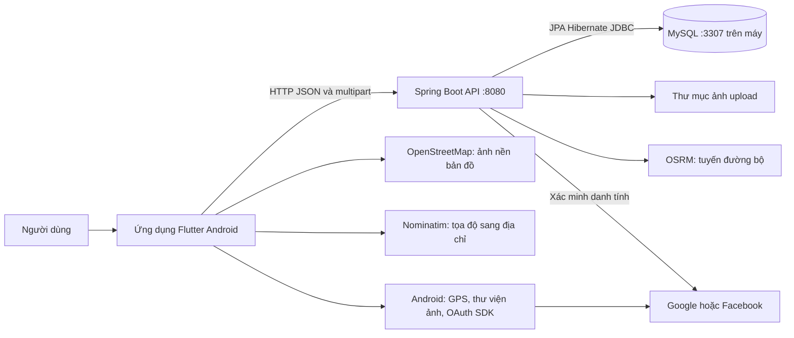

# Công nghệ đang dùng trong C-Store

Tài liệu này mô tả **những gì source của dự án đang làm**, không phải danh sách công nghệ nên cài thêm. Đọc [hướng dẫn lệnh và cấu hình](lenh-va-cau-hinh.md) để chạy dự án; đọc [thuật ngữ](thuat-ngu.md) nếu gặp từ mới.

Các phiên bản dưới đây lấy từ file cấu hình trong repository. Phiên bản khai báo trong source, phiên bản dependency được giải quyết trong lockfile và phiên bản công cụ đã cài trên máy là ba khái niệm khác nhau.

## 1. Nhìn toàn bộ hệ thống trước



Ứng dụng mobile hiển thị và nhận thao tác. Backend kiểm tra quyền, tính tiền và đọc/ghi dữ liệu. MySQL lưu dữ liệu nghiệp vụ. Ảnh nằm trong thư mục upload riêng; MySQL chỉ lưu đường dẫn. OSRM, tile bản đồ và Nominatim là các dịch vụ khác nhau, dù đều liên quan tới bản đồ.

Hệ thống hiện là **một backend và một app mobile**. Các package backend là cách tổ chức code trong cùng ứng dụng; chúng không phải các server độc lập.

## 2. Ngôn ngữ và nơi sử dụng

| Công nghệ | Trong dự án làm gì? | File nên mở |
| --- | --- | --- |
| Java | Xử lý API, tài khoản, sản phẩm, đơn hàng và quyền truy cập | `backend/src/main/java/` |
| Dart | Dữ liệu trong app, gọi API và dựng giao diện Flutter | `mobile/lib/` |
| Kotlin và Kotlin DSL | Cấu hình phần build Android, cầu nối Android của Flutter | `mobile/android/` và các file `.gradle.kts` |
| SQL/MySQL | Cách dữ liệu được lưu và truy vấn ở cơ sở dữ liệu | Entity/repository backend; database chạy bằng Docker |
| Python 3 | Công cụ log và các bài kiểm thử API/Android | `scripts/*.py` |
| Bash | Khởi động MySQL, build và chạy backend dưới systemd | `scripts/start-backend.sh` |
| XML | Maven POM và Android manifest/resources | `backend/pom.xml`, `AndroidManifest.xml` |
| YAML | Cấu hình Spring, dependency Flutter, Docker Compose | `application.yml`, `pubspec.yaml`, `docker-compose.yml` |
| JSON | Dữ liệu trao đổi API, cấu hình công khai khi build và báo cáo kiểm thử | Body HTTP và các file báo cáo local |
| Markdown | Tài liệu bạn đang đọc | `README.md`, `docs/huong-dan/` |

`database/` không phải nơi có migration SQL đang được chạy. Việc tạo/cập nhật bảng local hiện dựa trên entity JPA và `ddl-auto: update`.

## 3. Backend: Java, Spring Boot và Maven

### 3.1. Java chạy như thế nào?

Java source là các file `.java`. Maven biên dịch source thành bytecode `.class`, rồi đóng gói ứng dụng thành JAR. JVM là tiến trình thực thi bytecode đó. Khi bạn sửa `.java`, tiến trình backend đang chạy chưa tự có code mới: cần build và khởi động lại backend.

Trong [`backend/pom.xml`](../../backend/pom.xml), `java.version` khai báo `21`. Máy được rà soát khi thực hiện tài liệu có Java 25; lệnh `-Djava.version=25` là ghi đè cấu hình cho lần chạy Maven đó. Điều này không có nghĩa Flutter/Dart hay Android đều phải dùng Java 25.

### 3.2. Maven quản lý những gì?

Maven đọc `pom.xml` để biết tên dự án, dependency, phiên bản và cách đóng gói.

| Phần trong POM | Ý nghĩa |
| --- | --- |
| `groupId` | Nhóm dự án: `com.cstore` |
| `artifactId` | Tên gói backend: `cstore-simple-api` |
| `version` | Phiên bản ứng dụng backend: `0.1.0` |
| `parent` | Kế thừa cấu hình và bộ phiên bản dependency của Spring Boot |
| `properties` | Các giá trị cấu hình được tái sử dụng, ví dụ phiên bản Java |
| `dependencies` | Thư viện backend cần dùng |
| `scope: runtime` | Dependency cần khi ứng dụng chạy, như JDBC driver MySQL |
| `scope: test` | Dependency chỉ phục vụ kiểm thử, như H2 |
| `spring-boot-maven-plugin` | Đóng gói JAR chạy được và cung cấp `spring-boot:run` |

Spring Boot parent của source hiện là **3.4.12**. Các starter không khai báo version riêng vì parent quản lý version tương ứng. Không đọc tên `starter-test` rồi kết luận production có chạy server kiểm thử: `scope` của nó là `test`.

### 3.3. Những dependency backend thực sự được dùng

| Dependency | Vai trò | Điều xảy ra trong dự án |
| --- | --- | --- |
| `spring-boot-starter-web` | Web MVC và JSON HTTP API | Nhận request ở controller, chuyển JSON vào Java, trả DTO thành JSON |
| `spring-boot-starter-data-jpa` | Repository và ORM | Đọc/ghi entity, transaction, truy vấn và khóa bản ghi |
| `spring-boot-starter-security` | Lọc request và phân quyền | Kiểm tra người gọi được vào nhóm endpoint nào |
| `spring-boot-starter-oauth2-resource-server` | Xử lý Bearer JWT | Xác minh JWT của C-Store, chuyển claim vai trò thành authority |
| `spring-boot-starter-validation` | Bean Validation | Kiểm tra trường bắt buộc, email, độ dài, khoảng số trước khi xử lý |
| `mysql-connector-j` | JDBC driver MySQL | Kết nối backend với MySQL local |
| `spring-boot-starter-test` | JUnit, Spring Test, MockMvc và các công cụ test | Kiểm tra API/logic trong JVM |
| `h2` với scope test | Cơ sở dữ liệu phục vụ test | Chạy các bài backend bằng database trong bộ nhớ |

Một số thư viện được starter kéo gián tiếp: Jackson xử lý JSON; Hibernate hiện thực JPA; Nimbus xử lý JWT/JWK. Không cần thêm chúng vào POM chỉ vì thấy tên class được import: Maven có dependency bắc cầu.

### 3.4. Spring Boot khởi động và nối các class

`main()` gọi `SpringApplication.run(...)`. Spring tạo application context, đọc cấu hình, tìm các component trong package ứng dụng và tạo đối tượng phù hợp.

Các nhóm package có trách nhiệm khác nhau:

| Nhóm | Bạn nên tìm code gì ở đây? |
| --- | --- |
| `controller` | Đường dẫn API, HTTP method, nhận tham số/body, gọi xử lý nghiệp vụ |
| `service` | Quy tắc nghiệp vụ, tính phí, điều kiện trạng thái, phối hợp repository |
| `repository` | Đọc/ghi database, truy vấn theo thuộc tính, khóa bản ghi |
| `entity` | Cấu trúc dữ liệu được lưu trong bảng và quan hệ giữa bảng |
| `dto` | Dữ liệu nhận vào/trả ra API; không nhất thiết giống entity |
| `config` | Tạo bean và thiết lập ứng dụng |
| `security` | Bộ lọc, JWT, quyền và xác minh danh tính |

Constructor nhận dependency như repository hoặc service. Spring cung cấp đối tượng tương ứng; đó là dependency injection. Bạn không phải `new` toàn bộ cây backend bằng tay. Thư viện không tự đoán quy tắc đơn hàng: điều kiện về tồn kho, vai trò và trạng thái vẫn nằm trong code dự án.

### 3.5. Annotation phải đọc ra ý nghĩa

| Annotation | Đọc bằng tiếng Việt | Tác dụng trong dự án |
| --- | --- | --- |
| `@SpringBootApplication` | Đây là điểm bắt đầu ứng dụng Spring Boot | Bật cơ chế cấu hình và tìm component |
| `@RestController` | Class nhận HTTP và trả dữ liệu API | Giá trị trả về được chuyển thành response JSON |
| `@RequestMapping` | Tiền tố đường dẫn | Ghép với đường dẫn trên method |
| `@GetMapping` | Nhận GET ở đường dẫn này | Đọc dữ liệu |
| `@PostMapping` | Nhận POST | Tạo tài nguyên hoặc thực hiện hành động |
| `@PutMapping` | Nhận PUT | Cập nhật dữ liệu/trạng thái |
| `@DeleteMapping` | Nhận DELETE | Xóa hoặc ngừng hoạt động theo quy tắc dự án |
| `@RequestBody` | Lấy body HTTP để tạo đối tượng đầu vào | Đọc JSON đăng nhập, checkout, cập nhật |
| `@PathVariable` | Lấy giá trị trong đường dẫn | Ví dụ `{id}` của đơn hàng |
| `@RequestParam` | Lấy query/form parameter | Ví dụ `storeId`, trường upload `file` |
| `@Valid` | Yêu cầu kiểm tra constraint của đầu vào | Không tiếp tục xử lý DTO vi phạm validation |
| `@Service` | Đánh dấu thành phần xử lý nghiệp vụ | Spring quản lý vòng đời đối tượng |
| `@Configuration` | Class khai báo cấu hình | Chứa các method tạo bean |
| `@Bean` | Giá trị method trả về được Spring quản lý | PasswordEncoder, decoder, filter chain… |
| `@Value` | Đọc một cấu hình | URL routing, thư mục upload, thiết lập OAuth… |
| `@Transactional` | Chạy trong một giao dịch database | Gom các thay đổi tồn kho/đơn hàng thành một thao tác nhất quán |
| `@Entity` | Class biểu diễn dữ liệu trong database | JPA quản lý các đối tượng kiểu đó |
| `@Id` | Trường khóa chính | Xác định một bản ghi |
| `@GeneratedValue` | ID do cơ sở dữ liệu/cơ chế JPA cấp | Không tự lấy số bất kỳ làm ID mới |
| `@Enumerated` | Quy định cách lưu enum | Lưu vai trò, trạng thái theo cấu hình entity |
| `@ManyToOne`/`@OneToMany` | Quan hệ nhiều-một/một-nhiều | Đơn hàng và các dòng hàng, tài khoản và chi nhánh… |
| `@Lock` | Áp dụng cơ chế khóa cho truy vấn | Giảm xung đột khi hai thao tác cùng tranh một bản ghi |
| `@RestControllerAdvice` | Bộ xử lý lỗi dùng chung cho controller | Chuẩn hóa thông báo lỗi trả về mobile |
| `@ExceptionHandler` | Method nhận loại lỗi cụ thể | Chuyển exception thành status/body thích hợp |

Annotation có hiệu lực khi đối tượng/method đi qua cơ chế mà Spring/JPA quản lý. Nó không phải một dòng code Java được thực thi tuần tự như `total = price * quantity`.

## 4. MySQL, JPA, Hibernate và transaction

MySQL là chương trình cơ sở dữ liệu. JPA là API/cách mô tả lưu trữ đối tượng Java. Hibernate là thư viện thực hiện công việc JPA trong ứng dụng này. Spring Data JPA tạo phần hiện thực repository từ interface. JDBC driver là cầu kết nối tới MySQL.

Ví dụ luồng đọc dữ liệu:

```text
Controller nhận GET
  → service gọi repository
  → Hibernate tạo SQL
  → JDBC gửi SQL tới MySQL
  → MySQL trả các hàng dữ liệu
  → Hibernate dựng entity Java
  → code tạo DTO
  → Jackson tạo JSON response
```

Entity là cấu trúc lưu trữ. DTO là cấu trúc giao tiếp. Không trả thẳng entity chứa hash mật khẩu hay quan hệ nội bộ chỉ vì nó đang có đủ trường. Các DTO của dự án chọn trường cần trả cho app.

### Tại sao đặt đơn cần transaction và row lock?

Nếu còn một sản phẩm nhưng hai khách cùng đặt, thao tác “đọc tồn bằng 1 rồi giảm còn 0” có thể xảy ra hai lần nếu không phối hợp. Code checkout khóa các bản ghi liên quan, kiểm tra lại tồn, tạo snapshot đơn và trừ tồn trong giao dịch.

Transaction commit khi toàn bộ phần xử lý thành công. Exception có cơ chế rollback theo Spring transaction có thể hủy các thay đổi DB trong giao dịch; xem chi tiết luồng thực tế ở [backend](backend.md). Một thao tác HTTP ra OSRM hoặc ghi file upload không tự động biến thành thao tác có thể rollback giống hàng trong MySQL.

`open-in-view: false` có nghĩa không giữ persistence context mở xuyên toàn bộ giai đoạn dựng response để âm thầm tải thêm quan hệ. Service/controller phải chuẩn bị dữ liệu cần thiết trong phạm vi phù hợp.

`ddl-auto: update` đang dùng cho phát triển local. Nó giúp tạo/cập nhật bảng theo entity khi ứng dụng khởi động. Dự án chưa có bộ migration Flyway được áp dụng tự động; tách package Java không đồng nghĩa đổi cấu trúc bảng.

## 5. Đăng nhập và phân quyền

### 5.1. Đăng nhập email

1. Flutter gửi email và mật khẩu đến API đăng nhập.
2. Backend tìm tài khoản và kiểm tra điều kiện được đăng nhập.
3. `BCryptPasswordEncoder` so sánh mật khẩu nhập với hash được lưu.
4. Backend tạo **JWT của C-Store** và dữ liệu tài khoản.
5. App giữ JWT trong RAM; các request sau gắn Bearer header.
6. Backend xác minh JWT và kiểm tra quyền mỗi lần cần truy cập tài nguyên.

Hash BCrypt không phải bản mã để giải mã ra mật khẩu gốc. Code dùng encoder để tạo hash khi lưu và kiểm tra hash khi đăng nhập; không so mật khẩu bằng phép so chuỗi với cột hash.

### 5.2. JWT của C-Store

Source cấu hình chữ ký **HS256**, dùng khóa từ `JWT_SECRET`. Dự án kiểm tra độ dài khóa tối thiểu 32 ký tự. Payload có subject và các claim cần thiết; role được đổi thành authority có tiền tố `ROLE_`.

JWT được gửi qua cơ chế Bearer. Spring Security dùng decoder/converter để xác minh token và dựng đối tượng xác thực cho request; đây là cách Resource Server xử lý JWT. [Tài liệu Spring Security về JWT](https://docs.spring.io/spring-security/reference/servlet/oauth2/resource-server/jwt.html).

C-Store còn tra tài khoản trong DB, kiểm tra bị khóa/đã xóa và so claim phiên bản token với phiên bản hiện tại. Vì vậy một JWT chưa hết hạn vẫn có thể bị từ chối khi tài khoản hoặc phiên bản không còn hợp lệ. `STATELESS` ở đây nói về phiên HTTP của Spring Security; không có nghĩa backend hoàn toàn không tra DB.

App hiện không có cơ chế refresh-token/auto-login bền vững cho JWT. Không nhầm JWT của C-Store với token Google hoặc Facebook.

### 5.3. Ai được gọi API nào?

| Nhóm đường dẫn | Quyền trong cấu hình |
| --- | --- |
| POST `/api/auth/login`, `/register`, `/social` | Cho phép người chưa đăng nhập |
| GET `/api/products`, `/branches`, `/images/**`, `/auth/providers` | Có phần công khai theo cấu hình |
| `/api/admin/**` | ADMIN |
| `/api/merchant/**` | STORE hoặc MERCHANT tương thích ở backend |
| `/api/customer/**` | CUSTOMER |
| `/api/shipper/**` | SHIPPER |
| Các request còn lại | Phải xác thực |

Kiểm tra nhóm endpoint chỉ là lớp đầu. Code còn kiểm tra quyền sở hữu: cửa hàng không được sửa sản phẩm chi nhánh khác, shipper không được cập nhật đơn người khác đang giao, khách không được hủy đơn của khách khác.

### 5.4. Google và Facebook

Hai SDK trong app mở giao diện đăng nhập của nhà cung cấp và trả chứng cứ danh tính. Backend mới quyết định tài khoản C-Store và vai trò.

| Bước | Google | Facebook |
| --- | --- | --- |
| App lấy gì? | ID token từ Google Sign-In | Classic access token từ SDK Facebook |
| Backend xác minh thế nào? | Decoder dùng JWK của Google, rồi kiểm tra issuer, audience, thời gian và email đã xác minh | Gọi Graph API kiểm tra token/app/user/thời hạn, đọc profile và kiểm tra cùng user |
| Dữ liệu cấu hình liên quan | Client ID/server client ID | App ID, client token phía app; App Secret chỉ phía backend |
| Kết quả sau xác minh | Danh tính đã xác minh được liên kết vào tài khoản nội bộ | Tương tự |
| Token app dùng gọi C-Store sau đó | JWT do C-Store cấp | JWT do C-Store cấp |

Tài khoản tạo mới bằng luồng social được xử lý theo quy tắc trong service liên kết tài khoản; app không được tự gửi một role đặc quyền để trở thành admin. Hủy cửa sổ chọn tài khoản là kết quả bị hủy, không phải đăng nhập thành công.

## 6. Flutter, Dart và cấu trúc app

### 6.1. Flutter và Dart khác nhau chỗ nào?

Dart là ngôn ngữ. Flutter là bộ công cụ/thư viện dùng Dart để dựng UI. `main()` của mobile gọi `runApp(...)`; Flutter gắn widget gốc, chạy các method `build()` và vẽ giao diện.

`pubspec.yaml` khai báo Dart SDK `>=3.3.0 <4.0.0`. Đây là khoảng SDK mà dự án cho phép, không xác nhận máy đang cài Dart 3.3.0. Dùng `flutter --version` trong Kitty để xem công cụ thực tế.

| Khai báo package mobile | Vai trò trong source |
| --- | --- |
| `flutter`, từ SDK | Widget, Material, navigation, binding và nền tảng chạy UI |
| `cupertino_icons: ^1.0.8` | Bộ icon Cupertino được khai báo; không vì có dependency mà mọi icon đều là Cupertino |
| `http: ^1.6.0` | Request JSON, tải dữ liệu, multipart upload và HTTP geocoding |
| `flutter_map: ^8.3.2` | Vẽ bản đồ, tile layer, marker và polyline |
| `latlong2: ^0.10.1` | Kiểu tọa độ dùng trong bản đồ |
| `url_launcher: ^6.3.3` | Mở URI từ app, như gọi số điện thoại |
| `path_provider_android: 2.2.22` | Bản Android được ghim chính xác cho nhu cầu đường dẫn/cache trong dependency đồ thị |
| `geolocator: ^14.1.2` | Kiểm tra quyền/dịch vụ và đọc vị trí từ thiết bị |
| `image_picker: ^1.2.4` | Mở thư viện ảnh/camera qua nền tảng |
| `google_sign_in: ^7.2.0` | Giao tiếp Google Sign-In native |
| `flutter_facebook_auth: ^7.3.2` | Giao tiếp Facebook SDK native |
| `flutter_test`, từ SDK | Unit test và widget test |
| `flutter_lints: ^5.0.0` | Quy tắc phân tích tĩnh |
| `integration_test`, từ SDK | Kiểm thử app trên thiết bị/emulator |

Dấu `^` cho phép một khoảng phiên bản tương thích theo quy tắc pub; nó không khóa đúng một bản duy nhất. `2.2.22` không có `^` là ghim chính xác. Phiên bản đã giải quyết được ghi trong `pubspec.lock`; không tự thay dependency chỉ để học cách đọc code.

### 6.2. Widget là gì?

Widget mô tả giao diện tại một thời điểm. `Text` mô tả chữ, `Row` đặt con theo hàng ngang, `Column` theo cột, `ListView` cho nội dung cuộn, `Scaffold` cung cấp bố cục màn hình, `AppBar` là thanh trên.

`StatelessWidget` không có đối tượng `State` riêng. `StatefulWidget` đi cùng `State` để giữ dữ liệu UI như tab đang chọn, form, trạng thái đang gửi. `setState` yêu cầu dựng lại phần UI phụ thuộc vào state đó. `build()` có thể được gọi nhiều lần; không đặt thao tác tạo đơn hàng vào `build()`.

### 6.3. AppState và ChangeNotifier

`AppState` kế thừa `ChangeNotifier`. Khi dữ liệu dùng chung đổi, code gọi `notifyListeners()`; `ListenableBuilder` nghe thay đổi để dựng lại UI. Đây là cơ chế thông báo cập nhật, không phải cơ sở dữ liệu và cũng không tự gửi HTTP. [Giải thích ChangeNotifier của Flutter](https://docs.flutter.dev/data-and-backend/state-mgmt/simple).

Dự án truyền `AppState` vào màn hình và dùng `ListenableBuilder` trực tiếp. Không có dependency Provider/Riverpod/BLoC trong `pubspec.yaml`; ví dụ tài liệu ngoài dùng Provider không có nghĩa source này đang dùng Provider.

Mỗi nhóm code làm một việc:

```text
Widget màn hình: lấy dữ liệu form, nhận tap, hiển thị loading/lỗi
    → AppState: phối hợp đăng nhập/giỏ hàng/tải lại/dữ liệu phiên
    → AccountApi: HTTP, JSON, header, upload
    → Backend: xác thực, nghiệp vụ, database
    → Model Dart: chuyển JSON thành dữ liệu cho UI
```

Những dữ liệu như sản phẩm, đơn hàng, chi nhánh được tải từ API. Ảnh marketing trong `assets/images/` không phải bằng chứng app dùng catalog sản phẩm mẫu.

### 6.4. Bất đồng bộ trong app

| Cú pháp | Đọc như thế nào? |
| --- | --- |
| `Future<T>` | Sau này có kết quả kiểu `T`, hoặc lỗi |
| `async` | Hàm có thể chờ công việc bất đồng bộ |
| `await` | Chờ kết quả trước khi làm phần tiếp theo trong hàm |
| `try/catch/finally` | Thử làm, xử lý lỗi, rồi dọn trạng thái dù thành công hay thất bại |
| `Timer.periodic` | Đặt công việc lặp định kỳ |
| `Completer<T>` | Tự quản lý lúc hoàn thành một Future |
| `unawaited(...)` | Chủ động không chờ Future tại vị trí đó; không có nghĩa kết quả chắc chắn thành công |
| `mounted` | Đối tượng UI còn gắn với cây widget để cập nhật an toàn hay không |
| `dispose()` | Hủy timer/controller/client do đối tượng đó sở hữu |

`await` không có nghĩa toàn bộ điện thoại đứng yên chờ mạng. Các callback và tác vụ bất đồng bộ được phối hợp qua cơ chế chạy của Dart. Dự án dùng loading/busy để tránh gửi thao tác trùng và kiểm tra phiên/revision để tránh kết quả cũ ghi đè dữ liệu mới.

Polling đơn hàng hiện dùng chu kỳ 10 giây trong state. Đây là tải lại định kỳ bằng HTTP, không phải WebSocket hay thông báo push.

## 7. HTTP, JSON, multipart và mã lỗi

Request có method, URL, headers và body tùy thao tác. Response có status, headers và body.

| Thành phần | Ví dụ không chứa bí mật | Ý nghĩa |
| --- | --- | --- |
| Method | `GET` | Loại thao tác HTTP |
| Path | `/api/branches` | Tài nguyên/chức năng backend |
| Query | `?storeId=123` | Tham số đi cùng URL |
| JSON body | `{"name":"Sản phẩm học tập","stock":2}` | Dữ liệu đầu vào có cấu trúc |
| `Content-Type` | `application/json` | Body đang được gửi theo định dạng JSON |
| Authorization | `Bearer <JWT-cua-phien>` | Chứng cứ phiên; ký hiệu này chỉ là placeholder |
| Multipart field | `file` | Phần nhị phân của ảnh upload |

`jsonEncode` biến đối tượng Dart thành chuỗi JSON. `jsonDecode` đọc chuỗi JSON thành Map/List. `utf8.decode(response.bodyBytes)` giữ đúng chữ tiếng Việt khi giải mã byte response.

| Status | Cách hiểu thường gặp trong source |
| --- | --- |
| 200 | Thao tác thành công và có thể có body dữ liệu |
| 201 | Tạo thành công ở các endpoint khai báo mã này |
| 204 | Thành công, không có body để JSON decode |
| 400 | Đầu vào hoặc bước chuyển trạng thái không hợp lệ |
| 401 | Không xác thực được phiên/thông tin đăng nhập |
| 403 | Có điều kiện khiến tài khoản không được thực hiện thao tác |
| 404 | Không tìm thấy tài nguyên theo điều kiện endpoint |
| 409 | Xung đột dữ liệu/tranh chấp thao tác |
| 413 | Request upload vượt giới hạn |
| 503 | Dịch vụ cần thiết hiện không sẵn sàng |

Kiểm tra cả body `message` và nơi phát sinh lỗi để hiểu chính xác. Không suy ra mọi 403 đều đến từ filter: code nghiệp vụ cũng có thể chủ động trả status đó.

## 8. Ba phần bản đồ phải phân biệt

### 8.1. Nền bản đồ: flutter_map và OpenStreetMap

Tile là các ảnh vuông ghép thành nền bản đồ. Marker là ký hiệu vị trí; polyline là đường nối nhiều tọa độ. Tải được tile không đồng nghĩa đã tính được đường chạy xe. Các màn bản đồ giữ attribution; URL tile có thể cấu hình bằng `MAP_TILE_URL`.

### 8.2. Đường chạy xe: OSRM

Backend `RoutingService` gọi Route API của OSRM, nhận khoảng cách, thời gian dự kiến, tọa độ tuyến và hướng dẫn từng bước. URL API dùng thứ tự **kinh độ,vĩ độ**. Các tùy chọn như `steps`, `geometries=geojson` quyết định phần dữ liệu trả về. [OSRM Route API](https://project-osrm.org/docs/v5.24.0/api/#route-service).

Source gửi yêu cầu lấy các phương án và chọn tuyến có khoảng cách nhỏ nhất **trong các tuyến hợp lệ được OSRM trả về**. Không nên mô tả đây là chứng minh đường ngắn nhất tuyệt đối giữa mọi con đường trên bản đồ. Provider mặc định là endpoint demo công khai có thể thay bằng `ROUTING_BASE_URL`.

Quy tắc cục bộ trong code: xác thực tọa độ; không chấp nhận điểm snap quá xa mạng đường; cache tối đa 256 khóa, thời gian sống 10 phút; gửi yêu cầu tuần tự và giãn cách khoảng 1,1 giây. Khi không có kết quả đường bộ hợp lệ, backend trả lỗi thay vì âm thầm lấy Haversine làm phí đường bộ.

Hàm Haversine vẫn tồn tại trong model Dart để tính khoảng cách địa lý theo hai điểm. Sự tồn tại của hàm đó không có nghĩa phí giao hàng hiện được lấy từ đường chim bay. Báo phí/đơn hàng hiện dùng dữ liệu đường bộ do backend trả về.

### 8.3. Tọa độ sang địa chỉ: Nominatim

`GeocodingService` gọi reverse-geocoding để gợi ý địa chỉ tiếng Việt từ tọa độ. Source có debounce 400 ms, cache 100 kết quả và queue giãn khoảng 1,1 giây giữa các request trong cùng tiến trình app. Người dùng vẫn có thể sửa địa chỉ; kết quả geocoding không tự xác nhận người dùng đã ghim đúng cửa nhà.

Máy chủ Nominatim công khai có giới hạn tổng lưu lượng cho ứng dụng, yêu cầu nhận diện client/attribution và hạn chế các cách truy vấn hàng loạt. Queue trên một điện thoại không kiểm soát tổng traffic từ nhiều điện thoại. Khi tìm hiểu dịch vụ này, đọc [chính sách Nominatim](https://operations.osmfoundation.org/policies/nominatim/) cùng source; tài liệu không khẳng định cấu hình hiện tại bảo đảm tuân thủ ở mọi quy mô.

### 8.4. GPS từ Android

`geolocator` kiểm tra dịch vụ vị trí, xin quyền foreground và đọc vị trí với timeout. `LocationService` không tạo tọa độ mẫu khi GPS thất bại. App cho ghim tay nếu người dùng không lấy được GPS.

Lệnh ADB mô phỏng GPS trong test Android chỉ kiểm tra luồng emulator. Nó không chứng minh GPS trên điện thoại thật đã được thử, và khác với chức năng mô phỏng đến cửa hàng trong luồng shipper.

## 9. Ảnh, asset và lưu trữ

| Loại dữ liệu | Nằm ở đâu? | Được dùng ra sao? |
| --- | --- | --- |
| Logo app/ảnh trang chào | `mobile/assets/images/` | Đóng gói theo app; đọc bằng `Image.asset` |
| Ảnh sản phẩm/ảnh đại diện/logo cửa hàng upload | Thư mục `UPLOAD_DIR` của backend | Backend ghi file và trả URL `/api/images/...` |
| Đường dẫn ảnh | Database | Dùng để API trả lại URL cho mobile |
| Nội dung ảnh tạm/cache | Do thư viện/nền tảng quản lý | Không phải source code để chỉnh chức năng |

Backend giới hạn file upload, đọc ảnh để kiểm tra, giới hạn kích thước pixel, chuyển ảnh thành PNG và đặt tên UUID. Nó không chỉ tin phần đuôi file người dùng gửi. WebP được chấp nhận khi bộ đọc ảnh của runtime hỗ trợ; không phải mọi Java runtime đều tự có mọi decoder.

Ảnh logo dùng `BoxFit.cover` sẽ phủ kín khung và cắt phần dư. `BoxFit.contain` giữ toàn bộ ảnh trong khung nhưng có thể để trống. `ClipOval`/khung có clip quyết định vùng được nhìn thấy. Kích thước vòng tròn và tỉ lệ ảnh là hai thứ khác nhau.

## 10. Android, Gradle và cấu hình native

Flutter lo phần lớn giao diện, nhưng APK vẫn cần dự án Android để khai báo package, quyền, plugin native và build.

| Cấu hình source | Giá trị/ý nghĩa |
| --- | --- |
| Gradle wrapper | URL phân phối khai báo Gradle `9.3.1` |
| Android Gradle Plugin | Plugin `com.android.application` khai báo `9.1.0` |
| Kotlin plugin | Khai báo `2.4.0` trong settings |
| Namespace/applicationId | `com.example.cstore_mobile` theo cấu hình hiện tại |
| Java/Kotlin target Android | JVM 17 trong app Gradle |
| compileSdk/minSdk/targetSdk | Lấy từ cấu hình Flutter trong Gradle, không ghi cứng số ở file app |
| versionName/versionCode | Dẫn từ `version` trong `pubspec.yaml` |
| Internet/location | Khai báo trong manifest |
| HTTP local debug | Manifest debug bật cleartext để gọi backend local |

AGP, Gradle, Kotlin plugin và JDK là các thành phần khác nhau. Số phiên bản 17 của target Android không phải phiên bản Android trên emulator, cũng không phải `java.version` của backend.

Khi dùng `--dart-define`, Flutter truyền giá trị công khai cho Dart lúc build. App Gradle giải mã các mục cấu hình cần cho resource Facebook. File `social-auth.local.json` là cấu hình local đã được gitignore; tài liệu chỉ dùng tên biến, không sao chép giá trị cấu hình nhạy cảm.

App đang ký build release bằng debug signing theo cấu hình source. Đây là tình trạng hiện tại để hiểu dự án local; nó chưa là cấu hình phát hành lên cửa hàng ứng dụng. Dự án hiện chưa có cấu hình Flutter Web được dùng để chạy ứng dụng.

## 11. Docker Compose và systemd

Docker Compose trong dự án chạy **MySQL**, không chạy toàn bộ backend/mobile trong container. Container nghe cổng 3306; máy host ánh xạ `127.0.0.1:3307` tới nó. Backend trên host dùng cổng 3307.

Volume `cstore_mobile_mysql_data` giữ dữ liệu MySQL ngoài vòng đời một container. Backend upload dùng thư mục ảnh riêng, không nằm trong volume MySQL. Muốn sao lưu dữ liệu đầy đủ phải hiểu cả DB lẫn thư mục ảnh.

Healthcheck dùng `mysqladmin ping` để Compose biết MySQL đã sẵn sàng. `start-backend.sh` chờ trạng thái healthy rồi build/run backend. systemd user quản lý tiến trình Java dưới service `cstore-mobile-backend.service`; Kitty là nơi xem log, không phải nơi lưu database.

## 12. Python, Bash và các công cụ kiểm thử

| Công cụ/file | Làm gì? | Không nên hiểu nhầm |
| --- | --- | --- |
| `run-visible.py` | Mở/dùng lại cửa sổ Kitty, chạy lệnh trong PTY, phản chiếu log ra terminal và file | Không phải bộ test tự kiểm tra nghiệp vụ |
| `start-backend.sh` | Kiểm tra service/cổng, bật MySQL, Maven package, chạy Java bằng systemd | Nếu backend đã chạy thì script dùng lại, không tự rebuild mọi lần |
| `test-live.py` | Tạo dữ liệu QA riêng và kiểm tra API thật/MySQL/luồng đơn hàng | Không chạy trên database H2 và không reset dữ liệu có sẵn |
| `test-admin-brands-live.py` | Kiểm tra nhóm thương hiệu, chi nhánh, logo và vòng đời QA | Có tạo/xóa các bản ghi QA riêng |
| `test-ui-refinements-live.py` | Kiểm tra ngày tạo tài khoản và các quy tắc avatar qua API | Không phải thao tác UI Android |
| `test-android-live.py` | Chạy integration_test trên Android, hỗ trợ chọn ảnh và bơm GPS | Không chứng minh đã kiểm thử thiết bị vật lý |
| Maven/JUnit/MockMvc/H2 | Test backend trong JVM với DB test | Không thay cho kiểm tra hệ thống MySQL thật |
| `flutter analyze` | Kiểm tra tĩnh Dart và lint | Không chạy toàn bộ nghiệp vụ |
| `flutter test` | Unit/widget test trong môi trường kiểm thử Flutter | Không tự mở ứng dụng Android native |
| `flutter test integration_test/... -d ...` | Kiểm thử app trên thiết bị được chọn | Cần thiết bị/emulator và điều kiện của từng bài |

Python dùng thư viện chuẩn như `subprocess`, `pathlib`, `json`, `urllib`, `secrets`, `concurrent.futures`, `xml.etree.ElementTree`, `pty` và `fcntl` cho các nhiệm vụ trên. Đây không phải một backend Python thứ hai. Bash và Python phối hợp những chương trình đã có trên máy; Maven/Flutter/ADB vẫn phải được cài và nằm trong `PATH`.

## 13. Các khả năng và giới hạn cần nhớ khi đọc code

App có bốn giao diện: khách hàng, cửa hàng, shipper và admin. Hệ thống xử lý catalog, tồn kho, giỏ/checkout, đơn hàng, COD, hồ sơ/ảnh, vị trí/tuyến đường, tài khoản và thống kê theo các quy tắc trong source.

COD là ghi nhận thu tiền mặt trong quy trình giao hàng. Dự án chưa có cổng thanh toán ngân hàng/ví điện tử. Polling là tải lại qua HTTP, không phải push. Tuyến OSRM là dữ liệu định tuyến, không phải điều hướng GPS nền liên tục. Mọi dữ liệu tính tiền/trạng thái quan trọng phải đọc theo backend, không chỉ nhìn phép tính hiển thị bên Flutter.

Khi muốn biết một chức năng làm gì, hãy lần theo: **nút UI → method State → method API → controller → service → repository/entity → DTO trả về → UI dựng lại**. Các tài liệu [backend](backend.md) và [mobile](mobile-giao-dien.md) chỉ đường cho từng nhóm chức năng cụ thể.


## Công cụ tạo biểu tượng ứng dụng Android

`mobile/branding/app.png` là ảnh gốc do người dùng cung cấp. `scripts/GenerateAppIcons.java` dùng các lớp có sẵn trong Java SE (`ImageIO`, `BufferedImage`, `Graphics2D`) để tạo các PNG launcher theo mật độ màn hình. Đây là công cụ build tài nguyên, không phải endpoint Spring và không thêm dependency vào Flutter hoặc backend. Manifest vẫn dùng `@mipmap/ic_launcher`; Android chọn biến thể thích hợp. Xem [hướng dẫn icon](../../mobile/branding/README.md) để biết các kích thước và cách tạo lại.
