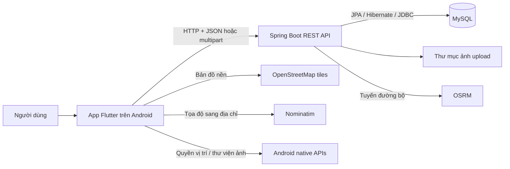
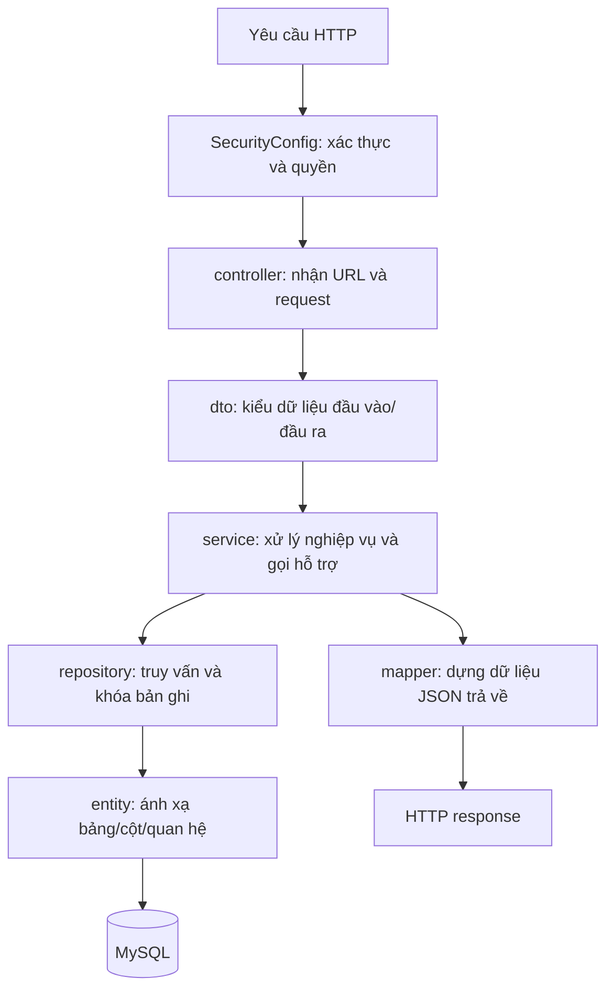
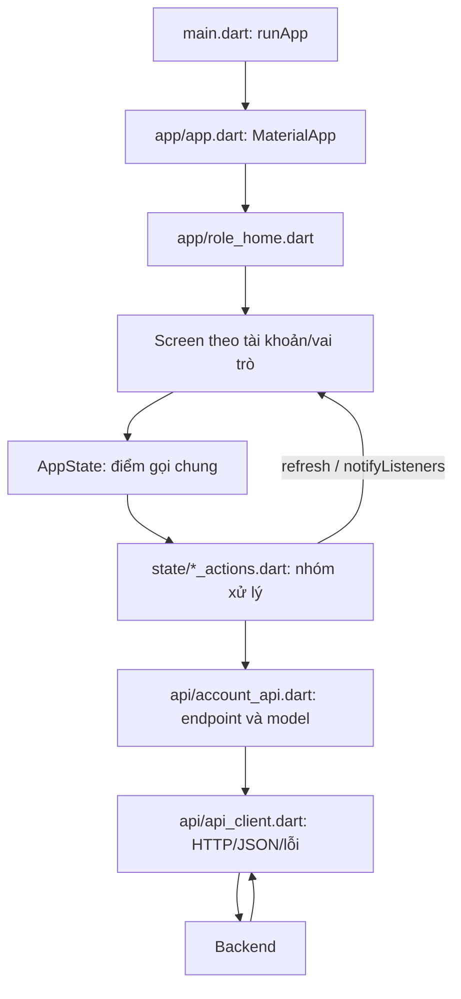

# Kiến trúc và luồng chạy

## 1. Ba phần chính của hệ thống

**Flutter** vẽ giao diện và giữ trạng thái tạm trong RAM. **Spring Boot** kiểm tra tài khoản/quyền, tính giá/phí và thay đổi dữ liệu. **MySQL** giữ dữ liệu nghiệp vụ sau khi ứng dụng đóng. File ảnh nằm trong thư mục upload của backend; database lưu đường dẫn ảnh, không lưu trực tiếp các byte PNG trong cột ảnh.

Không có một server riêng cho mỗi vai trò. Cả admin, cửa hàng, shipper và khách dùng cùng app và backend, nhưng các API có điều kiện quyền khác nhau. Đây là một backend nguyên khối được chia trách nhiệm trong cùng ứng dụng, không phải nhiều microservice.

## 2. Thư mục gốc

| Thư mục/tệp | Vai trò | Nên sửa khi nào? |
| --- | --- | --- |
| `backend/src/main/java` | Logic server Java | Đổi API, quyền, dữ liệu, xử lý đơn |
| `backend/src/main/resources/application.yml` | Cấu hình Spring và tham chiếu biến môi trường | Đổi cổng hoặc thông số backend |
| `backend/src/test` | Test Java với dữ liệu kiểm thử | Chứng minh quy tắc backend |
| `mobile/lib` | Dart viết giao diện và thao tác app | Đổi UI, luồng tương tác, cách nhận API |
| `mobile/assets/images` | Logo và ảnh giao diện đóng gói cùng app | Đổi asset tĩnh |
| `mobile/android` | Cấu hình nền tảng Android | Quyền, Gradle, plugin native |
| `mobile/test` | Unit/widget test Flutter | Kiểm tra logic và cây widget |
| `mobile/integration_test` | Test chạy trên thiết bị/emulator | Kiểm tra app và plugin Android thật |
| `database` | Script SQL của dự án | Đọc cách chuẩn bị dữ liệu ban đầu |
| `scripts` | Công cụ chạy và kiểm thử | Hiểu/lặp lại các thao tác terminal |
| `docs/huong-dan` | Sổ tay đang đọc | Học hoặc cập nhật thiết kế |
| `.local` | Log và dữ liệu QA riêng trên máy | Đọc báo cáo; không commit thông tin đăng nhập |
| `.env` | Giá trị cấu hình bí mật cục bộ | Chỉ chỉnh trên máy; không đưa vào tài liệu |

`backend/target`, `mobile/build`, `.dart_tool` là sản phẩm công cụ sinh ra. Không học kiến trúc bằng cách lần vào các thư mục này. Muốn đổi app/server thì sửa source và build lại.

## 3. Backend: một yêu cầu đi qua những lớp nào?

Sơ đồ thể hiện **trách nhiệm**, không phải mọi controller đều bắt buộc đi qua một chuỗi lớp dài. Với thao tác đơn giản, source hiện có controller gọi repository trực tiếp; các luồng chung hoặc phức tạp dùng service. Không tạo thêm service chỉ để chuyển tiếp một câu lệnh rồi làm người học khó lần theo.

- `controller`: tìm đúng chức năng từ method và URL, đọc request, trả status/JSON.
- `dto`: mô tả dữ liệu được phép nhận hoặc công khai; các `record` gom dữ liệu ngắn gọn.
- `service`: nghiệp vụ dùng lại, phiên đăng nhập, kiểm tra luồng thương mại và tuyến giao.
- `repository`: giao diện kế thừa `JpaRepository`; Spring tạo phần triển khai truy vấn khi chạy.
- `entity`: đối tượng gắn bảng SQL. Đổi tên field/annotation ở đây có thể tác động schema, khác hẳn đổi tên biến cục bộ.
- `mapper`: chọn những trường đưa ra API; không vô tình gửi `passwordHash` ra client.
- `config`/`security`: đăng ký bean, chuỗi lọc bảo mật và kiểm chứng danh tính nhà cung cấp.
- `support`: hàm chuẩn hóa/tái sử dụng nhỏ. `exception`: chuyển lỗi thành phản hồi HTTP thống nhất.

Tên package phải khớp thư mục. Ví dụ `entity/AppUser.java` khai báo `package com.cstore.app.entity;`. `import` giúp Java tìm các lớp ở package khác. Việc chỉ kéo file sang thư mục mà giữ package cũ không phải cách tổ chức được dùng ở đây.

## 4. Flutter: màn hình và dữ liệu

Các widget con nhận `AppState`, dữ liệu hoặc callback qua constructor. Không tự tạo `AppState()` mới cho từng tab, vì làm vậy sẽ sinh các giỏ hàng/phiên khác nhau. Những file `services/app_state.dart`, `services/account_api.dart`, `models/models.dart` có thể rất ngắn: chúng là **điểm export** để các import cũ vẫn dùng được; logic ở các file được export.

`part` trong `services/state` chia một thư viện Dart thành nhiều file. Nó không giống `import`, không tạo thêm đối tượng và không chạy một tiến trình khác. Các class `_SessionActions`, `_CatalogActions`... giữ tham chiếu `app` tới cùng một `AppState`. Dấu `_` làm tên private trong phạm vi thư viện Dart.

## 5. Luồng đăng nhập

1. Form kiểm tra email/mật khẩu ở app; biến `busy` ngăn bấm lặp trong lúc chờ.
2. `AppState.login` chuyển việc cho `_SessionActions.login`.
3. `AccountApi.login` gửi `POST /api/auth/login` với JSON.
4. `AuthController.login` tìm tài khoản và so mật khẩu với hash bằng `PasswordEncoder`.
5. `AccountService.session` kiểm tra điều kiện tài khoản và phát JWT; dữ liệu tài khoản trả về không có hash mật khẩu.
6. Flutter lưu JWT vào RAM của API client, lưu `Account`, tải chi nhánh và dữ liệu theo vai trò.
7. `notifyListeners` khiến `RoleHome` dựng lại màn đúng vai trò server trả về.
8. Những API sau mang JWT trong header `Authorization`. Backend kiểm tra lại quyền; sửa app để đổi role không cấp quyền server.

Đăng nhập Google/Facebook thêm bước plugin lấy chứng nhận của nhà cung cấp, backend kiểm chứng rồi mới tạo phiên C-Store. Token của nhà cung cấp và JWT C-Store có mục đích khác nhau. Chi tiết nằm ở chương công nghệ/backend.

## 6. Luồng đặt hàng và COD

1. Khách chọn chi nhánh, chọn điểm giao và thêm sản phẩm vào `cart`.
2. App xin báo giá giao từ backend; backend dùng tuyến đường bộ và quy tắc phạm vi/phí.
3. Checkout gửi mã sản phẩm và số lượng, không gửi giá để server tin tưởng.
4. Backend kiểm tra chi nhánh, tồn kho, tọa độ và ghim xác nhận; khóa dữ liệu phù hợp trong transaction.
5. Server tính tiền theo dữ liệu catalog hiện tại, trừ tồn và lưu snapshot tên/giá/số lượng vào dòng đơn.
6. Cửa hàng nhận hoặc từ chối; khách chỉ được hủy trong trạng thái cho phép. Hoàn tồn không được thực hiện hai lần.
7. Shipper online có ảnh và vị trí hợp lệ mới nhận đề nghị phù hợp. Server kiểm tra tranh chấp và số đơn đang nhận.
8. Các trạng thái lấy hàng/giao hàng/COD phải theo điều kiện server. Ghi nhận tiền là cập nhật dữ liệu, không phải thanh toán online qua ngân hàng.
9. App polling đơn/sản phẩm của khách, cửa hàng và shipper mỗi 10 giây. Báo cáo và danh sách admin tải riêng lúc mở, làm mới hoặc thực hiện thao tác. Đây không phải WebSocket hay push notification.

## 7. Những điều dễ nhầm khi sửa dự án

- `setState` dựng lại state của một widget; `AppState.refresh()` thông báo dữ liệu dùng chung đổi. Không phải thao tác lưu SQL.
- `await` chờ kết quả bất đồng bộ; không có nghĩa chặn toàn bộ giao diện Android.
- Model Dart là bản dữ liệu app đang biết, có thể cũ. Backend và database quyết định kết quả nghiệp vụ.
- File `export` không chứa bản triển khai thứ hai. Không chép lại cùng class vào cả file cũ và file mới.
- `@Transactional` liên quan transaction database; không biến mọi cuộc gọi mạng bên ngoài thành thao tác có thể rollback.
- Test H2 kiểm tra nhiều quy tắc nhưng không thay hoàn toàn test MySQL, thiết bị thật hoặc đăng nhập OAuth thật.

## 8. Sửa ở đâu theo yêu cầu thường gặp?

| Yêu cầu | Điểm bắt đầu |
| --- | --- |
| Đổi màu/font/bo góc chung | `mobile/lib/app/theme/app_theme.dart` |
| Đổi logo app hoặc vị trí nhãn vai trò | `mobile/lib/widgets/cstore_logo.dart` |
| Đổi màn sau khi đăng nhập | `mobile/lib/app/role_home.dart` |
| Đổi JSON/URL gửi API | `mobile/lib/services/api/` và controller tương ứng |
| Đổi xử lý giỏ hoặc nút đặt đơn | `services/state/cart_order_actions.dart`, `screens/customer/checkout_page.dart` |
| Đổi quy tắc quyền/phiên | `backend/.../config/SecurityConfig.java`, `service/AccountService.java` |
| Đổi quy tắc trạng thái đơn | `backend/.../controller/OrderController.java`, `service/CommerceSupport.java` |
| Đổi nguồn/logic tuyến giao | `backend/.../service/RoutingService.java`, `DeliveryService.java` |
| Hiểu một bảng và cách truy vấn | `backend/.../entity/` rồi `repository/` |

Trước khi đổi quy tắc, tìm cả nơi gọi và test liên quan. Sau khi đổi source, chạy checks qua Kitty và ghi rõ phần đã/chưa kiểm tra.
