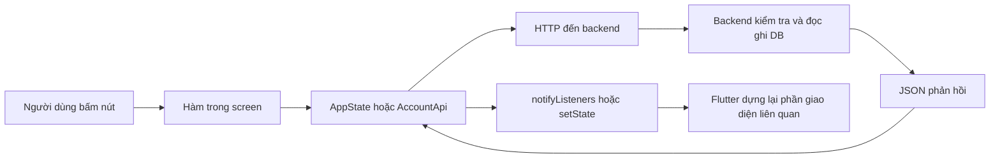

# Đọc và hiểu giao diện Flutter của C-Store

Tài liệu này giải thích phần `mobile/lib/screens` và `mobile/lib/widgets` sau khi tách file. Các tên lớp, chức năng, API và bố cục đang sử dụng được giữ nguyên. Việc tách file giúp bạn mở đúng phần cần học, thay vì đọc liên tục cả nghìn dòng của một màn hình.

Bạn nên mở tài liệu cạnh source trong hai cột của trình soạn thảo. Khi gặp một lời gọi hàm chưa hiểu, dùng **Go to Definition** để đi đến nơi khai báo hàm đó, đọc xong thì quay lại. Không cần học hết Flutter mới đọc được dự án: hãy đi lần lượt từ màn hình, sự kiện bấm nút, `AppState`, API, rồi backend.

## 1. Bản đồ thư mục

Các đường dẫn dưới đây bắt đầu từ `mobile/lib/`.

```text
screens/
├── auth/
│   └── welcome.dart                     Đăng nhập, đăng ký, nút Google/Facebook
├── customer/
│   ├── customer_home.dart               Trang chính của khách hàng
│   ├── shop_page.dart                   Sản phẩm của một chi nhánh
│   ├── cart_page.dart                   Xem và sửa số lượng trong giỏ
│   └── checkout_page.dart               Địa chỉ, báo giá và xác nhận đặt hàng
├── admin/
│   ├── admin_home.dart                  Giữ dữ liệu, tab, bộ lọc và thao tác quản trị
│   ├── models/
│   │   └── brand_option.dart            Gom chi nhánh thành lựa chọn thương hiệu
│   ├── pages/
│   │   ├── brand_detail_page.dart       Chi tiết doanh thu một thương hiệu
│   │   ├── create_partner_page.dart     Tạo thương hiệu/chi nhánh/tài khoản quản lý
│   │   └── create_account_page.dart     Tạo một tài khoản theo vai trò
│   └── widgets/
│       ├── admin_colors.dart            Màu sắc của nhóm quản trị
│       ├── admin_ui.dart                Nhãn vai trò, trường form, huy hiệu
│       ├── admin_brand_logo.dart        Khung logo thương hiệu
│       ├── admin_overview.dart          Ô thống kê và thẻ doanh thu
│       ├── admin_account_filters.dart   Các điều khiển lọc tài khoản
│       └── admin_account_card.dart      Một thẻ tài khoản và menu thao tác
├── store/
│   ├── store_home.dart                  Giữ tab/bộ lọc và nối sự kiện của cửa hàng
│   ├── product_editor.dart              Form tạo hoặc sửa sản phẩm
│   └── widgets/
│       ├── store_styles.dart            Màu sắc của nhóm cửa hàng
│       ├── store_components.dart        Khung nội dung, ô thống kê, dòng số liệu
│       ├── store_dashboard.dart         Tab báo cáo kinh doanh
│       ├── store_inventory.dart         Tab sản phẩm và tồn kho
│       └── store_branch_details.dart    Tab thông tin chi nhánh và tài khoản
├── shipper/
│   ├── shipper_home.dart                Bật/tắt trực tuyến, đơn giao, hồ sơ
│   ├── navigation_route.dart            Trang bản đồ và thao tác lấy hàng
│   └── models/
│       └── delivery_navigation.dart     Bước chỉ dẫn, chặng đường, hành trình
├── profile/
│   ├── profile_page.dart                Xem hồ sơ, chuyển sang chỉnh sửa
│   ├── pages/
│   │   ├── edit_profile_page.dart       Sửa tên, điện thoại, giới tính, ảnh
│   │   └── change_password_page.dart    Kiểm tra và đổi mật khẩu
│   └── widgets/
│       ├── profile_colors.dart          Màu của nhóm hồ sơ
│       └── profile_menu_tile.dart       Một dòng menu hồ sơ
├── orders.dart                          Xuất lại hai trang trong orders/
├── orders/
│   ├── order_list_page.dart             Lọc và xem lịch sử đơn theo vai trò
│   └── order_detail_page.dart           Thông tin đơn, hóa đơn, các nút thao tác
└── location_picker.dart                 Ghim vị trí và xác nhận địa chỉ

widgets/                                 Thành phần dùng chung nhiều vai trò
├── account_avatar.dart                  Ảnh đại diện hoặc logo thương hiệu
├── common.dart                          Tiêu đề, trạng thái trống, báo lỗi, hộp nhập
├── cstore_logo.dart                     Logo ứng dụng và nhãn vai trò
├── date_filter.dart                     Bộ lọc ngày dùng chung
├── map_zoom_controls.dart               Các nút phóng to, thu nhỏ, vừa tuyến
├── order_widgets.dart                   Thẻ đơn, dòng sản phẩm, dòng số tiền
├── product_image.dart                   Ảnh từ asset hoặc backend
└── sync_status.dart                     Thông báo lỗi đồng bộ dữ liệu
```

`pages/` chứa một trang hoàn chỉnh có thể mở bằng `Navigator`. `widgets/` bên trong một vai trò chứa phần giao diện chỉ phục vụ vai trò đó. `widgets/` ở ngay dưới `lib/` chứa phần dùng chung nhiều vai trò. `models/` trong nhóm shipper và admin chỉ phục vụ dữ liệu hiển thị của nhóm đó; các mô hình nghiệp vụ chung vẫn nằm trong `lib/models/`.

Một số file cũ có lệnh `export`, ví dụ `screens/orders.dart`:

```dart
export 'orders/order_list_page.dart';
export 'orders/order_detail_page.dart';
```

`export` cho phép file khác tiếp tục import `screens/orders.dart` rồi dùng `OrderList` và `OrderDetail`. Hai lớp đã được chuyển ra hai file riêng; chúng không bị sao chép thành hai bản. Cách này giữ các import hiện có và bộ test tương thích trong lúc tổ chức lại source.

## 2. Phân biệt dữ liệu, trạng thái và giao diện

| Phần | Trả lời câu hỏi | Ví dụ |
| --- | --- | --- |
| Model | Một dữ liệu có những thuộc tính nào? | `Account`, `Branch`, `Product`, `ShopOrder` |
| `AppState` | Ứng dụng đang biết dữ liệu gì, người dùng đang làm gì? | Tài khoản hiện tại, giỏ, các đơn đã tải |
| `AccountApi` | Gửi và nhận dữ liệu từ server ra sao? | Đăng nhập, tải danh sách, tải ảnh |
| Screen/page | Cả trang hiển thị gì và xử lý sự kiện nào? | `AdminHome`, `CheckoutPage` |
| Widget/hàm dựng UI | Một phần của trang trông như thế nào? | `AccountAvatar`, `buildStoreInventory` |

Giao diện không truy cập MySQL trực tiếp. Dòng gọi `widget.state.api.request(...)` cũng không chạy câu SQL trong điện thoại. Nó gửi HTTP đến backend. Backend xác thực, kiểm tra nghiệp vụ rồi mới đọc/ghi database.



## 3. Cách đọc một cây widget

Ví dụ thật trong `widgets/cstore_logo.dart`:

```dart
Widget build(BuildContext context) => Row(
  mainAxisAlignment: MainAxisAlignment.spaceBetween,
  children: [
    const Flexible(child: CStoreLogo()),
    if (subtitle != null)
      Padding(
        padding: const EdgeInsets.only(left: 12),
        child: Text(
          subtitle!,
          style: const TextStyle(fontSize: 14, fontWeight: FontWeight.w600),
        ),
      ),
  ],
);
```

Đọc từ ngoài vào trong, theo từng lệnh:

1. `Widget build(BuildContext context)` khai báo hàm mô tả giao diện. `context` là vị trí của widget trong cây; từ đó Flutter tìm được theme, kích thước, `Navigator` hoặc `ScaffoldMessenger` ở phía trên.
2. `=> Row(...)` trả về một hàng ngang. Dấu `=>` là cách viết ngắn cho thân hàm gồm một biểu thức trả về.
3. `mainAxisAlignment: ...spaceBetween` đặt khoảng trống còn lại giữa hai thành phần chính trong hàng.
4. `children: [...]` là danh sách các widget con theo thứ tự từ trái sang phải.
5. `Flexible(...)` cho phép vùng logo nhận ít chiều rộng hơn khi không đủ chỗ. Nó không tự tạo một ảnh mới.
6. `CStoreLogo()` dựng widget logo dùng chung. Tên lớp bắt đầu bằng chữ hoa theo quy ước Dart.
7. `if (subtitle != null)` trong danh sách có nghĩa là chỉ thêm widget tiếp theo nếu có nhãn vai trò.
8. `Padding` tạo khoảng đệm cho nhãn. `EdgeInsets.only(left: 12)` chỉ thêm 12 đơn vị logic ở bên trái.
9. `Text(subtitle!)` hiển thị chuỗi vai trò. Dấu `!` nói với trình kiểm tra kiểu rằng giá trị tại đây không null; điều kiện ở trên là lý do dùng được.
10. `TextStyle` thiết lập cỡ và độ đậm chữ. Nó không làm thay đổi chuỗi `subtitle`.
11. Các dấu `)`, `]` và `,` cuối phần này lần lượt đóng lời gọi hàm, đóng danh sách và phân tách đối số. Dấu phẩy cuối giúp formatter đặt các thuộc tính thành nhiều dòng dễ nhìn.

Ảnh logo app dùng `Image.asset`, nghĩa là đọc ảnh được đóng gói trong app. `fit: BoxFit.cover` giữ tỉ lệ ảnh, phủ vùng hiển thị và có thể cắt phần vượt khung. Ảnh thương hiệu trong khung tròn cũng phủ khung theo yêu cầu giao diện; không ép toàn bộ ảnh vào một hình tròn nhỏ. Thanh trên trang cửa hàng không còn avatar/logo chi nhánh nằm cạnh logo app.

Các widget thường gặp:

| Widget | Đọc như thế nào? |
| --- | --- |
| `Scaffold` | Khung một trang: thanh trên, nội dung, nút nổi, thanh dưới |
| `SafeArea` | Chừa vùng để nội dung không đè vào phần giao diện hệ thống |
| `Column` / `Row` | Xếp các con theo chiều dọc / ngang |
| `ListView` | Danh sách có thể cuộn theo trục chính |
| `Expanded` | Bắt buộc lấp phần không gian còn lại trong `Row`/`Column` |
| `Flexible` | Cho phép co vùng con theo không gian còn lại |
| `SizedBox` | Tạo vùng có kích thước xác định hoặc khoảng trống |
| `Padding` | Tạo khoảng đệm quanh một con |
| `Container` | Kết hợp kích thước, đệm, trang trí và con |
| `Stack` / `Positioned` | Chồng các con và đặt con tại tọa độ trong vùng cha |
| `TextFormField` | Ô nhập có thể gắn bộ kiểm tra của `Form` |
| `FilledButton` | Nút có callback; `onPressed: null` làm nút bị vô hiệu hóa |
| `RefreshIndicator` | Khi kéo làm mới, chạy hàm `Future` được truyền vào |
| `ListenableBuilder` | Dựng lại vùng con khi đối tượng được nghe phát thông báo |
| `ClipOval` / `ClipRRect` | Cắt phần vẽ của con theo hình bầu dục / chữ nhật bo góc |

Kích thước Flutter thường là **logical pixel**. Con số `52` trong code không nhất thiết là 52 điểm ảnh vật lý trong ảnh chụp emulator. Tỉ lệ điểm ảnh của thiết bị quyết định mối quan hệ đó.

## 4. StatefulWidget, State và vòng đời

Lấy `StoreHome` làm ví dụ:

```dart
class StoreHome extends StatefulWidget {
  const StoreHome({super.key, required this.state});
  final AppState state;

  @override
  State<StoreHome> createState() => _StoreHomeState();
}
```

1. `class StoreHome` đặt tên kiểu widget.
2. `extends StatefulWidget` cho biết widget có một đối tượng `State` giữ các giá trị thay đổi theo thời gian.
3. Constructor nhận `state`. `required` bắt nơi tạo widget phải truyền giá trị này.
4. `super.key` chuyển key đến constructor của lớp cha; key giúp Flutter nhận diện widget khi đối chiếu cây cũ và cây mới.
5. `final AppState state` giữ tham chiếu được truyền vào. `final` ngăn gán một tham chiếu khác cho trường này; đối tượng `AppState` bên trong vẫn có thể thay đổi dữ liệu.
6. `@override` thông báo hàm bên dưới thực hiện lại một thành viên do lớp cha khai báo.
7. `State<StoreHome>` là state gắn với đúng kiểu widget `StoreHome`.
8. `_StoreHomeState()` tạo đối tượng chứa tab, bộ lọc và các hàm xử lý sự kiện. Tên bắt đầu `_` là private trong thư viện Dart, không phải private theo thư mục.

Các bước thường gặp:

```text
Tạo widget → createState → initState → build
                               ↓
                    setState / notifyListeners
                               ↓
                              build
                               ↓
                    rời màn hình → dispose
```

- `initState()` chạy một lần cho mỗi đối tượng state, không phải một lần cho cả ứng dụng.
- `build()` có thể chạy nhiều lần. Nó nên đọc dữ liệu hiện tại và tạo cây widget; không đặt một yêu cầu tải mạng mới không kiểm soát ngay trong `build`.
- `setState(() { ... })` đổi dữ liệu của state cục bộ và đề nghị Flutter dựng lại vùng tương ứng.
- `widget.state.refresh()` hoặc một hàm `AppState` có `notifyListeners()` thông báo cho các vùng đang nghe đối tượng state.
- `dispose()` giải phóng controller/listener khi trang kết thúc. Không giải phóng chúng có thể làm listener cũ tiếp tục hoạt động hoặc giữ tài nguyên không cần thiết.

Ở `StoreHome`, tab, từ khóa, danh mục và bộ lọc tồn kho vẫn nằm trong `_StoreHomeState`. Việc đổi tab không chuyển chúng thành một tài khoản hay phiên dữ liệu mới. Các hàm trong `store/widgets/` nhận giá trị và callback từ màn hình, nên không phải tự sở hữu một bản `AppState` khác.

## 5. Callback: nối một widget nhỏ với màn hình chính

Trong `StoreHome` có đoạn:

```dart
buildStoreInventory(
  state: s,
  search: search,
  stockFilter: stockFilter,
  category: category,
  onSearchChanged: (value) => setState(() => search = value),
  onCategoryChanged: (value) => setState(() => category = value),
  onStockFilterChanged: (value) => setState(() => stockFilter = value),
  onEdit: editProduct,
)
```

1. `buildStoreInventory` là hàm tạo nội dung tab sản phẩm, khai báo trong `store/widgets/store_inventory.dart`.
2. `state: s` truyền đối tượng state hiện tại. Trong file này `s` là getter viết ngắn cho `widget.state`.
3. Ba dòng tiếp theo truyền **giá trị hiện tại** của từ khóa, trạng thái tồn kho và danh mục.
4. `onSearchChanged` truyền một **hàm**, chưa chạy ngay lúc dựng widget.
5. Khi người dùng gõ, ô nhập trong widget nhỏ gọi hàm đó cùng chuỗi mới.
6. `(value) => ...` là hàm ẩn danh có một tham số tên `value`.
7. `setState(() => search = value)` gán chuỗi mới vào state màn hình chính rồi dựng lại UI.
8. Widget nhỏ nhận `search` mới ở lần dựng tiếp theo và lọc lại danh sách.
9. `onEdit: editProduct` truyền tham chiếu đến hàm mở trang sửa sản phẩm. Viết `onEdit: editProduct()` sẽ chạy hàm ngay và có ý nghĩa khác.

Đây là lý do tách widget vẫn giữ được luồng xử lý dễ lần theo: dữ liệu đi xuống bằng tham số, sự kiện đi lên bằng callback.

## 6. Đọc từng bước của đăng nhập

Mở [welcome.dart](../../mobile/lib/screens/auth/welcome.dart) và tìm `submit()`.

| Lệnh/nhóm lệnh thật | Điều xảy ra |
| --- | --- |
| `Future<void> submit() async` | Khai báo tác vụ bất đồng bộ; không trả dữ liệu nghiệp vụ cho nơi gọi |
| `if (busy) return;` | Nếu đang gửi một lần trước đó thì dừng, tránh bấm lặp |
| `if (!form.currentState!.validate()) return;` | Chạy validator của các ô trong Form; dữ liệu sai thì chưa gọi mạng |
| `setState(() { busy = true; ... })` | Hiện trạng thái đang chờ và xóa lỗi/thông báo cũ |
| `try { ... }` | Bắt đầu nhóm lệnh có thể phát sinh lỗi khi gọi server |
| `if (registering)` | Chọn luồng đăng ký hay luồng đăng nhập theo chế độ hiện tại |
| `await widget.state.register(...)` | Chờ luồng tạo tài khoản rồi đăng nhập của `AppState` |
| `await widget.state.login(...)` | Chờ backend xác minh tài khoản; client không tự quyết định vai trò |
| `catch (e)` | Bắt lỗi từ các bước chờ bên trong `try` |
| `if (mounted)` | Chỉ cập nhật UI nếu trang vẫn còn trong cây |
| `e is StateError ? e.message : ...` | Hiện thông báo dự kiến hoặc một thông báo chung dễ hiểu |
| `finally` | Luôn chạy phần kết thúc sau thành công hoặc lỗi |
| `setState(() => busy = false)` | Bật lại nút và dừng vòng chờ |

`await` không có nghĩa là đóng băng toàn bộ giao diện. Hàm hiện tại tạm dừng để chờ kết quả; framework vẫn có thể vẽ màn hình và xử lý các sự kiện khác. Vì vậy cần `busy` để ngăn gửi lặp, và cần kiểm tra `mounted` vì người dùng có thể rời trang trong thời gian chờ.

`Form` dùng `GlobalKey<FormState>` để screen lấy được state của form. Các `TextEditingController` giữ nội dung ô nhập. `email.text` lấy chuỗi đang có trong ô email; nó không phải truy vấn database. `dispose()` của trang gọi `dispose()` cho từng controller khi không dùng nữa.

Đăng nhập mạng xã hội đi qua `socialLogin(SocialProvider provider)`. `activeProvider` phục vụ hiển thị trạng thái nút nào đang chờ. Đóng bộ chọn tài khoản có thể là một kết quả hủy thông thường; không nên hiểu mọi lần hủy đều là lỗi đăng nhập. Cấu hình provider và việc xác minh token nằm ngoài widget, trong các service và backend.

## 7. Quản trị: từ tải dữ liệu đến thay đổi tài khoản

### `AdminHome` giữ việc gì?

| Thành viên | Trách nhiệm |
| --- | --- |
| `accounts` | Danh sách tài khoản đã được tải; null nghĩa là chưa có kết quả tải thành công |
| `revenue` | JSON báo cáo doanh thu do backend trả về |
| `tab` | Tab tổng quan, thương hiệu hoặc tài khoản |
| `filter`, `search`, `accountDates`, `newestFirst` | Các lựa chọn lọc và sắp xếp của người dùng |
| `loading` | Đang tải dữ liệu toàn màn hình |
| `mutating` | Đang thực hiện thao tác thay đổi dữ liệu, ví dụ cấm tài khoản |
| `showArchived` | Chọn danh sách đang hoạt động hay lịch sử đã ngừng |
| `brands` | Getter lấy các hàng thương hiệu từ kết quả báo cáo |

`load()` thực hiện theo thứ tự: bật `loading`, tải tài khoản, tải chi nhánh, cập nhật tài khoản nếu còn mounted, tải `/admin/revenue`, kiểm tra kiểu dữ liệu rồi cập nhật báo cáo. Khi có lỗi, screen xóa báo cáo hiện tại và ghi thông báo lỗi. Phần `finally` tắt `loading` nếu trang vẫn còn.

`build()` lọc danh sách trong bộ nhớ, không gọi MySQL. Ví dụ `.where((a) => !a.deleted)` giữ các tài khoản chưa bị xóa. `inDateRange(...)` kiểm tra ngày tạo. `.toList()` tạo danh sách kết quả; cascade `..sort(...)` sắp xếp chính danh sách vừa tạo rồi vẫn trả nó cho biến nhận. Lịch sử từ backend không bị xóa khi người dùng chỉ thay đổi bộ lọc màn hình.

### Các file quản trị gọi nhau như thế nào?

```text
AdminHome.load
  ├── AccountApi.accounts
  ├── AppState.reloadBranches
  └── AccountApi.request('/admin/revenue')

AdminHome.build
  ├── buildAdminOverview                  → admin_overview.dart
  ├── buildAdminBrandCard                 → admin_overview.dart
  ├── buildAdminAccountFilters            → admin_account_filters.dart
  └── buildAdminAccountCard               → admin_account_card.dart

Người dùng chọn menu trên một thẻ tài khoản
  → onAction
  → AdminHome.editAccount
  → showDialog xác nhận
  → PUT/DELETE đến API
  → load lại dữ liệu
```

`buildAdminAccountFilters` nhận các callback riêng cho vai trò, từ khóa, khoảng ngày, thứ tự và đặt lại. Nó không tự ghi database. `buildAdminAccountCard` nhận `onAction`; tên hành động được truyền trở về screen, nơi có quyền hỏi xác nhận và gửi API.

### Tạo cửa hàng không tạo trùng khi tải logo lỗi

Mở [create_partner_page.dart](../../mobile/lib/screens/admin/pages/create_partner_page.dart), tìm `save()`:

1. Nếu `busy` thì dừng.
2. Nếu chưa có `createdStoreId`, kiểm tra form, vị trí được ghim và logo cần thiết.
3. Bật trạng thái chờ.
4. Nếu chưa có ID, gửi `createStore(...)` với tên thương hiệu, tên chi nhánh, địa chỉ, tọa độ, email và thông tin tài khoản quản lý.
5. Lấy `created['storeId'] as int` và giữ trong `createdStoreId`.
6. Nếu có ảnh mới, tải ảnh đến API của ID vừa nhận.
7. Tải lại danh sách chi nhánh rồi `Navigator.pop(context, true)`.
8. Nếu bước tải ảnh lỗi sau khi ID đã có, giao diện báo rằng tài khoản đã tạo và cho thử tải logo lại. Lần sau không gửi tạo cửa hàng thêm lần nữa.
9. Luôn kết thúc trạng thái chờ ở `finally`.

`CreateAccount` áp dụng ý tưởng tương tự với `createdId`. Lựa chọn vai trò quyết định có phải chọn chi nhánh hoặc có bắt buộc ảnh shipper hay không. Backend vẫn kiểm tra quyền và tính hợp lệ của yêu cầu; form phía mobile chủ yếu giúp người dùng nhận phản hồi sớm.

### Gom các chi nhánh thành thương hiệu

Mở [brand_option.dart](../../mobile/lib/screens/admin/models/brand_option.dart):

```dart
final groups = <String, List<Branch>>{};
for (final b in branches) {
  groups.putIfAbsent(normalizeBrandName(b.brand ?? b.name), () => []).add(b);
}
```

1. Dòng đầu tạo map rỗng: khóa là chuỗi, giá trị là danh sách chi nhánh.
2. Vòng `for` lấy từng chi nhánh trong danh sách.
3. `b.brand ?? b.name` dùng tên thương hiệu nếu có, nếu null thì dùng tên chi nhánh.
4. `normalizeBrandName` bỏ khoảng trắng đầu/cuối, chuyển chữ thường và gộp khoảng trắng để gom nhóm ổn định.
5. `putIfAbsent(key, () => [])` chỉ tạo danh sách rỗng nếu map chưa có khóa này; nếu đã có thì trả danh sách hiện có.
6. `.add(b)` thêm chi nhánh vào đúng nhóm.
7. Phần sau của hàm đổi từng nhóm thành `BrandOption`, tạo list và sắp xếp theo tên. Đây là xử lý dữ liệu cho ô chọn trên UI, không phải tạo thương hiệu mới trong database.

## 8. Cửa hàng: báo cáo, tồn kho và thông tin chi nhánh

`StoreHome` giữ phần điều phối. Ba tab nội dung chính nhận `AppState` và callback:

| File | Đọc dữ liệu gì? | Khi người dùng thao tác |
| --- | --- | --- |
| `store_dashboard.dart` | `storeOrders`, sản phẩm, `reportDates`, `StoreMetrics` | Đổi khoảng ngày hoặc yêu cầu chuyển tab |
| `store_inventory.dart` | Sản phẩm đang hoạt động của chi nhánh, từ khóa, danh mục, mức tồn | Gọi callback sửa bộ lọc hoặc mở editor |
| `store_branch_details.dart` | Chi nhánh, tài khoản phụ trách, logo | Làm mới, mở đổi mật khẩu hoặc đăng xuất |
| `product_editor.dart` | Sản phẩm được chọn hoặc form mới | Kiểm tra form, lưu dữ liệu, tải ảnh |

`StoreMetrics` là phần tính toán số liệu, không phải widget. Dashboard dùng kết quả tính đó để vẽ doanh thu, phí nền tảng 15%, tiền dự kiến cửa hàng nhận, số đơn và tồn kho. Tiền hàng và phí giao được trình bày riêng. Cách tách này cho phép đọc/test công thức mà không cần lần theo toàn bộ cây widget.

Trong inventory, các bước là: chọn sản phẩm thuộc chi nhánh hiện tại và còn hoạt động → lấy danh mục hợp lệ → lọc theo danh mục/tên/tồn kho → sắp theo tên → vẽ danh sách. Bấm một bộ lọc chỉ đổi cách xem. Sửa tồn kho thật sự đi qua `ProductEditor` và API.

Ngưỡng hiển thị “Sắp hết” trong code là còn từ 1 đến 5 sản phẩm. `stock == 0` là “Hết hàng”. Biểu thức `categories.contains(category) ? category : 'Tất cả danh mục'` giúp màn hình quay về một lựa chọn hợp lệ nếu danh mục cũ không còn trong dữ liệu đã tải mới.

## 9. Khách hàng: từ giỏ đến đơn hàng

```text
CustomerHome
  → chọn chi nhánh
ShopPage
  → tăng/giảm số lượng
CartPage
  → tiếp tục đặt hàng
CheckoutPage
  → ghim điểm giao + nhập thông tin người nhận
  → lấy báo giá
  → xác nhận đặt hàng
OrderDetail
```

| Trang | Hàm hoặc dữ liệu nên đọc |
| --- | --- |
| `CustomerHome` | Cách chọn vị trí, danh sách chi nhánh gần, chọn tab hồ sơ/đơn |
| `ShopPage` | Cách lấy sản phẩm chi nhánh, lọc sản phẩm, gọi `state.change` |
| `CartPage` | `state.cart.entries`, ID sản phẩm là key, số lượng là value |
| `CheckoutPage` | `initState`, `loadQuote`, hàm mở bản đồ, `submit`, `dispose` |

`state.product(e.key)` tìm thông tin sản phẩm theo ID có trong giỏ. `e.value` là số lượng của sản phẩm đó. `state.subtotal` là tạm tính tiền hàng, chưa phải lý do để tin rằng server chắc chắn sẽ chấp nhận đơn: backend còn phải kiểm tra lại sản phẩm, tồn kho, tọa độ và các điều kiện nghiệp vụ.

`CheckoutPage` có controller địa chỉ, vĩ độ, kinh độ và cờ `pinConfirmed`. Nó dùng một mã `quoteRevision` để nhận biết phản hồi báo giá còn phù hợp hay đã cũ. Nếu người dùng vừa đổi điểm giao, không nên lấy kết quả của điểm giao trước đó để hiển thị như báo giá mới.

Ghim tọa độ và có chuỗi địa chỉ là hai phần khác nhau. Tên địa chỉ dùng để người dùng/người giao đọc; tọa độ phục vụ tính tuyến và vị trí. Không coi một ô địa chỉ đã gõ là bằng chứng điểm đã được ghim đúng.

## 10. Đơn hàng dùng chung ba vai trò

[orders.dart](../../mobile/lib/screens/orders.dart) xuất lại hai lớp:

- `OrderList` nằm trong `orders/order_list_page.dart`.
- `OrderDetail` nằm trong `orders/order_detail_page.dart`.

`OrderList` chọn nguồn theo vai trò: cửa hàng dùng `storeOrders`, shipper dùng `deliveries`, khách dùng `customerOrders`. Sau đó nó lọc ngày/trạng thái, sắp đơn mới trước và vẽ `OrderPreview`. Vì vậy cùng một trang lịch sử có thể dùng cho nhiều vai trò mà không trộn nguồn đơn giữa họ.

`OrderDetail` tìm lại đơn theo ID trong state mới nhất; nếu chưa có thì dùng đơn được truyền vào trang. Bước này giúp màn hình đang mở vẫn nhận được thay đổi từ đồng bộ dữ liệu thay vì giữ mãi một bản đơn cũ.

Các hàm chính:

| Hàm | Công việc |
| --- | --- |
| `run(action)` | Chặn bấm lặp, chạy tác vụ qua `attempt`, kết thúc trạng thái chờ |
| `date(value)` | Đưa thời điểm về giờ local và tạo chuỗi dễ đọc |
| `panel(child)` | Bọc một nhóm nội dung vào khung thống nhất |
| `build(context)` | Dựng trạng thái đơn, người nhận, tài xế, sản phẩm và hóa đơn |
| `actions(order)` | Chọn những nút phù hợp với vai trò/trạng thái |

Ví dụ khách thấy nút hủy khi đơn còn chờ xác nhận; cửa hàng thấy chấp nhận/từ chối; shipper thấy nhận giao và các bước giao tiếp theo. Không nên tự thay trạng thái đơn trong widget để bỏ qua API. Các nút gọi `AppState.transition`, `claim` hoặc `pay`; backend mới thực hiện chuyển trạng thái hợp lệ và lưu dữ liệu.

Nút gọi điện dùng `launchUrl(Uri(scheme: 'tel', path: ...))` để yêu cầu hệ điều hành mở trình xử lý cuộc gọi. Điều đó không phải một cuộc gọi HTTP đến backend và cũng không tự bảo đảm rằng cuộc gọi đã kết nối.

## 11. Bản đồ, GPS và phản hồi cũ

### Trang chọn vị trí

`LocationPicker` giữ ghim, controller địa chỉ và trạng thái chờ. `choose(point)` nhận tọa độ mới rồi gọi `GeocodingService.reverse(...)` để tìm địa chỉ. Người dùng vẫn có thể nhập/sửa địa chỉ khi dịch vụ không trả được kết quả phù hợp.

Ví dụ cốt lõi:

```dart
final requestId = ++geocodeRevision;
final result = await geocodingService.reverse(point.latitude, point.longitude);
if (!mounted || requestId != geocodeRevision) return;
```

1. `++geocodeRevision` tăng số phiên yêu cầu và trả số mới; biến `requestId` giữ số riêng của lần gọi này.
2. Hàm `reverse` chạy bất đồng bộ. Trong lúc chờ, người dùng có thể chọn một ghim khác, làm `geocodeRevision` tăng lần nữa.
3. Khi phản hồi trở về, nếu trang đã đóng hoặc mã không còn khớp thì dừng.
4. Chỉ phản hồi của ghim mới nhất được dùng để cập nhật địa chỉ. Đây là cách tránh phản hồi chậm ghi đè lựa chọn mới.

`canConfirm` yêu cầu có ghim và địa chỉ không trống; nó còn xét việc tìm địa chỉ đang chạy và người dùng có tự sửa địa chỉ hay chưa. Nút xác nhận vì vậy phụ thuộc dữ liệu hợp lệ, không chỉ phụ thuộc việc bản đồ đã mở.

### Dữ liệu hành trình của shipper

Trong `shipper/models/delivery_navigation.dart`:

| Lớp | Ý nghĩa |
| --- | --- |
| `RoadStep` | Một hướng dẫn như đi thẳng/rẽ/vòng xuyến, tên đường và số mét |
| `RoadLeg` | Một chặng gồm khoảng cách, thời gian dự kiến, tọa độ và các bước |
| `DeliveryNavigation` | Toàn bộ hành trình: tài xế, cửa hàng, khách và chặng đang hoạt động |

`RoadStep.instruction` dùng `switch` để đổi loại điều hướng và hướng rẽ thành câu tiếng Việt. `RoadStep.icon` chọn icon tương ứng. Đó là phần **trình bày** chỉ dẫn đã có, không phải thuật toán tìm đường mới trong điện thoại.

`RoadLeg.fromJson` đọc tọa độ JSON theo thứ tự longitude/latitude rồi tạo `LatLng(latitude, longitude)`. Đảo nhầm hai số có thể đặt tuyến vào sai vị trí; vì vậy cần đọc rõ thứ tự của API và constructor.

`navigation_route.dart` giữ phần màn hình: `MapController`, camera, tải route, cập nhật GPS và lấy hàng. `sync()` tạo một chữ ký từ ID đơn, trạng thái, tọa độ và chế độ mô phỏng. Nếu chữ ký không đổi thì không tải tuyến lặp vô ích. `load()` dùng `requestId` để bỏ qua phản hồi tuyến đã cũ tương tự cơ chế geocoding.

`FlutterMap` vẽ nền bản đồ, `TileLayer` tải các ô ảnh bản đồ, `PolylineLayer` vẽ tuyến, `MarkerLayer` vẽ vị trí. Có nền bản đồ không có nghĩa là có tuyến đường; ngược lại, khi tải ảnh nền lỗi, dữ liệu tuyến và số km vẫn có thể tồn tại.

`fit()` tập hợp các tọa độ liên quan rồi yêu cầu camera vừa toàn bộ vùng đó. Nó cần `mapReady` vì controller chỉ thao tác được khi bản đồ sẵn sàng. `addPostFrameCallback` đợi framework hoàn thành một khung vẽ trước khi chỉnh camera dựa trên dữ liệu mới.

Nhánh mô phỏng lấy hàng được gắn cờ riêng và yêu cầu hộp xác nhận. GPS emulator/mô phỏng dùng để kiểm tra phần mềm; nó không chứng minh độ chính xác cảm biến trên điện thoại thật.

## 12. Hồ sơ và ảnh đại diện

| File | Đường đọc nên theo |
| --- | --- |
| `profile_page.dart` | `initState → refresh → build → edit` |
| `pages/edit_profile_page.dart` | Khởi tạo controller → chọn ảnh → kiểm tra form → lưu → dispose |
| `pages/change_password_page.dart` | Ba controller → validator → save → AppState/API |
| `widgets/profile_menu_tile.dart` | Dựng một dòng menu và gắn callback |

`AccountAvatar` chọn ảnh theo thứ tự: đường dẫn được truyền trực tiếp, ảnh tài khoản, ảnh mặc định phù hợp hoặc icon khi chưa có ảnh. Khách hàng có ảnh mặc định theo lựa chọn giới tính. Shipper chưa có ảnh không được coi như đã có ảnh người giao thật; giao diện sẽ nhắc bổ sung ảnh nếu dữ liệu tài khoản yêu cầu.

Ảnh tải từ backend đi qua `ProductImage`. Đường dẫn bắt đầu bằng `assets/` dùng `Image.asset`; đường dẫn còn lại được ghép với `AccountApi.base` rồi dùng `Image.network`. Khi đang tải hoặc gặp lỗi, widget có placeholder để không làm sập toàn bộ danh sách.

`ChangePasswordPage` kiểm tra các ô hiện tại/mới/nhập lại. Chuỗi có ký tự Unicode có thể có số byte UTF-8 khác số ký tự; validator có kiểm tra độ dài byte theo giới hạn đang dùng. Thành công của form local chưa có nghĩa mật khẩu hiện tại đúng: backend vẫn phải xác minh và thực hiện thay đổi.

## 13. Danh mục widget dùng chung

| File | Thành viên | Khi nào nên mở để đọc? |
| --- | --- | --- |
| `common.dart` | `orange`, `heading`, `empty`, `attempt`, `ask` | Muốn hiểu cách các trang thống nhất tiêu đề, trạng thái rỗng và lỗi |
| `cstore_logo.dart` | `CStoreLogo`, `CStoreAppBarTitle` | Muốn đổi vị trí/kích thước logo app và nhãn vai trò |
| `account_avatar.dart` | `AccountAvatar` | Muốn hiểu ảnh cá nhân, ảnh mặc định và logo cửa hàng |
| `product_image.dart` | `ProductImage` | Muốn hiểu URL ảnh, asset, loading/error placeholder |
| `date_filter.dart` | `DateFilterBar`, các hàm ngày/khoảng ngày | Muốn hiểu bộ lọc ngày của đơn và báo cáo |
| `order_widgets.dart` | `StatusPill`, `OrderItemRow`, `OrderPreview`, `AmountRow` | Muốn đọc các mảnh hóa đơn/đơn dùng lại nhiều trang |
| `map_zoom_controls.dart` | `MapZoomControls` | Muốn hiểu các nút điều khiển camera bản đồ |
| `sync_status.dart` | `SyncStatus` | Muốn hiểu cách báo đồng bộ lỗi mà nội dung vẫn còn |

`attempt(context, action)` nhận một callback có thể chạy đồng bộ hoặc trả `Future` qua kiểu `FutureOr<void>`. Nó chờ tác vụ; nếu gặp `StateError` thì hiển thị thông báo cụ thể bằng snackbar, còn lỗi khác hiển thị thông báo chung. `context.mounted` được kiểm tra trước khi dùng context sau thời gian chờ.

`ask(...)` tạo controller tạm, mở dialog và chờ chuỗi trả về. `Navigator.pop(c, controller.text)` đóng dialog kèm giá trị. Hàm đợi animation kết thúc trước khi dispose controller, tránh giải phóng controller trong khi ô nhập của dialog vẫn còn được framework dùng.

## 14. Những ký hiệu Dart cần hiểu để đọc source

| Ký hiệu/lệnh | Ý nghĩa trong dự án |
| --- | --- |
| `final` | Chỉ gán biến/trường một lần; không đồng nghĩa đối tượng bên trong bất biến |
| `const` | Giá trị/constructor hằng khi đủ điều kiện; giúp khai báo cấu hình không đổi |
| `String?` | Có thể là chuỗi hoặc null |
| `value ?? fallback` | Dùng fallback khi value là null |
| `object?.field` | Chỉ đọc field nếu object khác null |
| `value!` | Khẳng định khác null; dùng sai sẽ có lỗi runtime |
| `condition ? a : b` | Chọn một trong hai biểu thức |
| `as int`, `as Map<...>` | Ép kiểu theo cấu trúc đã biết của dữ liệu |
| `(value as num).toDouble()` | Nhận số JSON có thể là int/double rồi chuẩn hóa thành double |
| `is`, `is!` | Kiểm tra kiểu; không tự biến JSON sai thành dữ liệu đúng |
| `=>` | Thân hàm trả về một biểu thức |
| `() => action()` | Hàm ẩn danh không tham số, thường dùng làm callback |
| `async` / `await` | Khai báo và chờ một bước bất đồng bộ |
| `try/catch/finally` | Chạy tác vụ, xử lý lỗi, rồi dọn trạng thái cuối |
| `return` | Kết thúc hàm ngay tại điểm đó |
| `.where(...)` | Giữ các phần tử thỏa điều kiện |
| `.map(...)` | Đổi mỗi phần tử sang một dạng khác |
| `.toList()` | Thu kết quả thành danh sách |
| `.fold(...)` | Gộp nhiều phần tử thành một giá trị, ví dụ tổng tiền |
| `..sort(...)` | Gọi sort trên đối tượng trước `..` và vẫn trả chính đối tượng đó |
| `...items` | Trải các phần tử của một danh sách vào danh sách đang dựng |
| `if (...)` trong `children` | Thêm widget có điều kiện |
| `for (...)` trong `children` | Tạo widget cho từng phần tử dữ liệu |
| `'$value'`, `'${expression}'` | Chèn giá trị/biểu thức vào chuỗi |
| `import` | Cho file hiện tại dùng tên được công khai từ thư viện khác |
| `export` | Cho nơi import file hiện tại dùng các tên được công khai từ file được xuất lại |

`buildStoreDashboard`, `buildAdminOverview` là các hàm Dart thông thường trả widget hoặc danh sách widget. `build` có tên giống nhau trong các lớp Flutter vì framework gọi nó để dựng giao diện. Không nên nhầm mọi hàm bắt đầu `build...` đều tự động được framework gọi: các hàm helper chỉ chạy tại nơi source gọi chúng.

## 15. Cách sửa và học theo từng bước nhỏ

1. Chọn một hành vi nhìn thấy được, ví dụ ô tìm sản phẩm.
2. Tìm chuỗi nhãn của nó trong source, mở `store_inventory.dart`.
3. Đọc `onChanged` để biết sự kiện phát đi đâu.
4. Quay về `StoreHome`, đọc callback để thấy biến `search` được cập nhật.
5. Đọc biểu thức `.where(...)` để biết biến đó tác động danh sách như thế nào.
6. Chạy test liên quan qua `scripts/run-visible.py`; xem log trực tiếp trong Kitty.
7. Hot reload lên phiên Flutter đang mở và xem thay đổi trên emulator.
8. Khi đã hiểu, thử giải thích lại bằng lời: “Gõ chuỗi mới → callback → setState → lọc danh sách → dựng lại UI”. Nếu nói được luồng này thì bạn đã hiểu phần chính, không chỉ nhớ tên widget.

Khi học phần tạo đơn, làm tương tự nhưng theo thêm qua `AppState`, `AccountApi`, endpoint backend, service và repository. Khi học tính doanh thu, bắt đầu từ `StoreMetrics` và dữ liệu đơn, sau đó mới quay lại widget hiển thị số.

Những file chỉ đổi định dạng có thể dài hơn trước vì mỗi thuộc tính và dấu đóng được đặt trên dòng riêng. Điều cần giảm là số trách nhiệm trong một file và độ lồng khó nhìn, không phải ép tổng số dòng càng ít càng tốt. Không cần sửa các thư mục build/cache để thay đổi giao diện; source cần đọc ở `mobile/lib`, test ở `mobile/test` và `mobile/integration_test`.


## Biểu tượng ứng dụng ngoài màn hình Android

Ảnh gốc của biểu tượng ứng dụng là [`mobile/branding/app.png`](../../mobile/branding/app.png), lấy từ ảnh `Pictures/app.png` do người dùng cung cấp ngày 03/11/2026. Đây là icon launcher nhìn thấy ở danh sách ứng dụng/màn hình chính Android. Logo chữ nằm trong các trang Flutter vẫn do `CStoreLogo` và asset `assets/images/cstore-logo.png` hiển thị.

Manifest trỏ tới `@mipmap/ic_launcher`; mỗi thư mục mật độ màn hình có một bản PNG tương ứng. Công cụ Java `scripts/GenerateAppIcons.java` dùng JDK có sẵn để tạo các bản này, giữ tỉ lệ và phần trong suốt. Không cần thêm dependency Flutter. Hướng dẫn thay ảnh, kích thước và build/cài lại nằm ở [tài liệu biểu tượng](../../mobile/branding/README.md). Hot reload không nạp lại launcher icon vì nó thuộc tài nguyên Android native.
